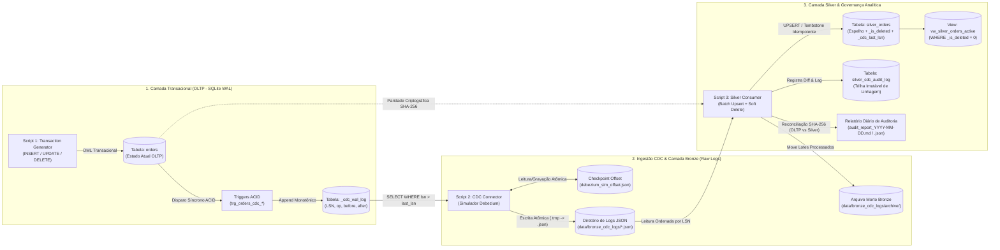
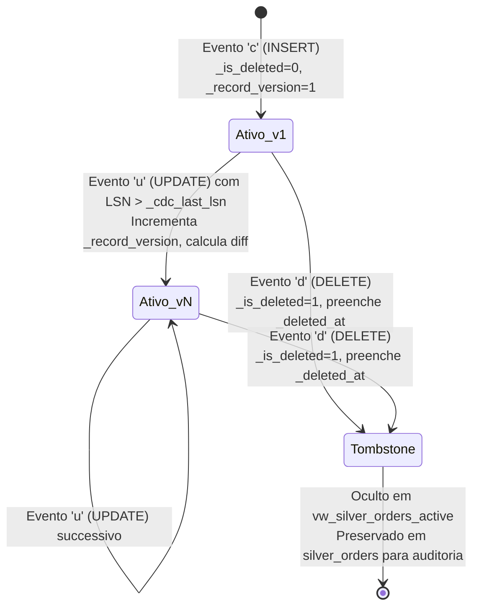

# Pipeline de Change Data Capture (CDC) — Simulação End-to-End (SQLite -> Debezium JSON -> Camada Silver)

Projeto de Engenharia de Dados que simula, ponta a ponta e sem dependências externas pesadas (100% Python Standard Library + SQLite 3 em modo `WAL`), um pipeline moderno de **Change Data Capture (CDC)** seguindo a **Arquitetura Medallion (OLTP -> Bronze -> Silver)** com garantias de atomicidade ACID, escrita atômica de logs, idempotência por *Log Sequence Number (LSN)*, *Soft-Delete (Tombstones)* e reconciliação criptográfica (`SHA-256`).

---

## Sumário

1. [Fundamentos de Arquitetura de Streaming e CDC](#1-fundamentos-de-arquitetura-de-streaming-e-cdc)
2. [Diagramas Conceituais da Arquitetura](#2-diagramas-conceituais-da-arquitetura)
3. [Estrutura do Projeto no Monorepo](#3-estrutura-do-projeto-no-monorepo)
4. [Detalhamento Técnico dos 3 Componentes](#4-detalhamento-técnico-dos-3-componentes)
5. [Envelope de Eventos CDC (Padrão Debezium)](#5-envelope-de-eventos-cdc-padrão-debezium)
6. [Garantias de Engenharia: Entrega, Idempotência e Auditoria](#6-garantias-de-engenharia-entrega-idempotência-e-auditoria)
7. [Instruções de Execução](#7-instruções-de-execução)
8. [Suíte de Testes Automatizados](#8-suíte-de-testes-automatizados)

---

## 1. Fundamentos de Arquitetura de Streaming e CDC

**Change Data Capture (CDC)** é o padrão arquitetural de engenharia de dados responsável por identificar, capturar e propagar mutações (`INSERT`, `UPDATE`, `DELETE`) ocorridas em bancos transacionais (OLTP) para plataformas analíticas (Data Lakes, Lakehouses e Data Warehouses) com baixa latência e sem impactar a performance transacional.

### Comparativo de Abordagens de CDC na Indústria

| Critério Técnico | 1. Query-Based CDC (Polling `updated_at`) | 2. Trigger / Transactional Outbox CDC *(Implementado no SQLite)* | 3. Log-Based CDC Nativo *(Debezium + Postgres WAL / MySQL Binlog)* |
| :--- | :--- | :--- | :--- |
| **Mecanismo de Captura** | `SELECT * FROM tabela WHERE updated_at > ?` | Triggers ACID (`AFTER INSERT/UPDATE/DELETE`) gravam em tabela interna `_cdc_wal_log` | Leitura direta do log binário de replicação física do SGBD |
| **Captura de `DELETE` Físico** | **Não captura** (a linha deixa de existir no banco de origem) | **Sim** (captura `OLD.*` no campo `before` antes da remoção) | **Sim** (lê o evento de remoção diretamente do WAL/Binlog) |
| **Captura de Estados Intermediários** | **Não** (se um pedido mudar de status 3x entre dois ciclos de polling, apenas o último é visto) | **Sim** (cada transação gera um `LSN` sequencial próprio) | **Sim** (todas as transações confirmadas estão no log) |
| **Estado `BEFORE` vs `AFTER`** | Apenas estado atual (`AFTER`) | Completo (`before` e `after` serializados em JSON) | Completo (`before` e `after` via `REPLICA IDENTITY FULL`) |
| **Consistência Transacional** | Sujeita a *race conditions* e *clock skew* | **100% ACID** (trigger roda na mesma transação do DML) | **100% ACID** (lê apenas transações com `COMMIT`) |

> [!NOTE]
> Como o SQLite é um banco embarcado serverless e não expõe slots de replicação lógica de rede como o PostgreSQL (`pgoutput`), este projeto implementa uma camada de **Write-Ahead Change Log transacional (`_cdc_wal_log`)** alimentada por **Database Triggers nativas com `json_object()`**. Isso garante que até mesmo mutações executadas fora do Python (ex: via CLI do SQLite ou DBeaver) sejam capturadas atomicamente com seu estado `BEFORE` e `AFTER`.

---

## 2. Diagramas Conceituais da Arquitetura

### 2.1. Arquitetura Fim-a-Fim (Medallion CDC Pipeline)



### 2.2. Diagrama de Sequência: Fluxo Transacional e Garantia de Entrega

```mermaid
sequenceDiagram
    autonumber
    participant App as 1. Gerador OLTP
    participant DB as SQLite (orders + _cdc_wal_log)
    participant CDC as 2. Conector CDC (Debezium Sim)
    participant FS as Camada Bronze (JSON Logs + Offset)
    participant Silver as 3. Consumidor Silver (Warehouse)

    App->>DB: BEGIN; UPDATE orders SET status='PAID' WHERE order_id='ORD-01';
    Note over DB: Trigger trg_orders_cdc_update captura<br/>OLD (before) e NEW (after) com LSN=42
    DB-->>App: COMMIT Confirmado

    CDC->>FS: Lê último LSN em debezium_sim_offset.json (ex: LSN=40)
    CDC->>DB: SELECT * FROM _cdc_wal_log WHERE lsn > 40 ORDER BY lsn ASC
    DB-->>CDC: Retorna eventos LSN 41..42
    CDC->>FS: Grava cdc_events_lsn_000041_000042.json.tmp + fsync()
    CDC->>FS: os.replace(.json.tmp -> .json) (Atômico)
    CDC->>FS: Atualiza debezium_sim_offset.json (last_lsn = 42)

    Silver->>FS: Lista lotes pendentes cdc_events_lsn_*.json
    Silver->>Silver: Valida SHA-256 do arquivo em silver_processed_batches
    Silver->>Silver: Verifica idempotência por linha (incoming_lsn > _cdc_last_lsn)
    Silver->>Silver: Aplica UPSERT / Soft-Delete em silver_orders + Grava silver_cdc_audit_log
    Silver->>FS: Move lote JSON processado para bronze_cdc_logs/archive/
    Silver->>DB: Executa Reconciliação SHA-256 (orders vs vw_silver_orders_active)
    Silver->>FS: Emite Relatório Diário (audit_report_YYYY-MM-DD.md & .json)
```

### 2.3. Máquina de Estados do Registro na Camada Silver



---

## 3. Estrutura do Projeto no Monorepo

```text
06-cdc-kafka-simulation/
├── README.md                           # Documentação técnica e arquitetural
├── run_pipeline.py                     # Orquestrador End-to-End (simulação multi-ondas)
├── scripts/
│   ├── 1_transaction_generator.py      # Ponto de entrada CLI - Componente 1 (Gerador OLTP)
│   ├── 2_cdc_connector.py              # Ponto de entrada CLI - Componente 2 (Conector CDC)
│   └── 3_silver_consumer.py            # Ponto de entrada CLI - Componente 3 (Consumidor Silver)
├── src/
│   ├── __init__.py
│   ├── config.py                       # Configuração imutável de diretórios e logging estruturado
│   ├── database.py                     # DDL SQLite, modo WAL, Triggers ACID e Views Silver
│   ├── transaction_generator.py        # Motor de geração de transações (INSERT/UPDATE/DELETE)
│   ├── cdc_connector.py                # Leitor de log WAL, serializador Debezium e checkpoint LSN
│   └── silver_consumer.py              # Ingestão batch idempotente, reconciliação e relatório diário
├── tests/
│   ├── __init__.py
│   └── test_cdc_pipeline.py            # Testes unitários e de integração fim-a-fim
└── data/                               # Gerado automaticamente em tempo de execução
    ├── oltp/
    │   └── oltp_source.db              # Banco relacional transacional (orders + _cdc_wal_log)
    ├── bronze_cdc_logs/
    │   ├── cdc_events_lsn_*.json       # Lotes JSON aguardando processamento
    │   └── archive/                    # Lotes JSON já ingeridos pela camada Silver
    ├── checkpoints/
    │   └── debezium_sim_offset.json    # Persistência atômica de offset (last_lsn) do conector
    ├── silver/
    │   └── warehouse_silver.db         # Camada Silver (silver_orders + silver_cdc_audit_log)
    └── reports/
        ├── audit_report_YYYY-MM-DD.md  # Relatório Diário de Auditoria em Markdown
        └── audit_report_YYYY-MM-DD.json# Relatório Diário de Auditoria estruturado em JSON
```

---

## 4. Detalhamento Técnico dos 3 Componentes

### Componente 1: Gerador de Transações OLTP (`scripts/1_transaction_generator.py`)
- Simula operações de e-commerce na tabela `orders` (`order_id`, `customer_id`, `customer_name`, `product_sku`, `category`, `quantity`, `unit_price`, `total_amount`, `status`, `payment_method`, `region`, `created_at`, `updated_at`).
- Executa uma distribuição configurável de operações:
  - **`INSERT` (55%)**: Criação de novos pedidos com status inicial `CREATED`.
  - **`UPDATE` (30%)**: Progressão realista da máquina de estados (`CREATED -> PAID -> SHIPPED -> DELIVERED` ou `CANCELLED`/`REFUNDED`) e ajustes de quantidade no carrinho com recálculo de `total_amount`.
  - **`DELETE` (15%)**: Exclusão física (`DELETE FROM orders WHERE order_id = ?`) simulando expurgo operacional ou remoção de pedidos cancelados/fraudulentos.
- As **Triggers SQLite** (`trg_orders_cdc_insert`, `trg_orders_cdc_update`, `trg_orders_cdc_delete`) interceptam cada comando DML dentro da mesma transação e gravam o registro em `_cdc_wal_log`.

### Componente 2: Leitor / Conector CDC (`scripts/2_cdc_connector.py`)
- Simula o comportamento de um conector **Debezium**:
  1. Carrega o último `LSN` processado a partir de `data/checkpoints/debezium_sim_offset.json`.
  2. Consulta `SELECT * FROM _cdc_wal_log WHERE lsn > ? ORDER BY lsn ASC LIMIT ?`.
  3. Empacota cada linha no formato canônico Debezium (`schema` + `payload` contendo `before`, `after`, `source`, `op`, `ts_ms`).
  4. Escreve o lote em um arquivo temporário `.json.tmp`, força o *flush* físico para o disco (`os.fsync`) e renomeia atomicamente (`os.replace`) para `cdc_events_lsn_<min>_<max>_<timestamp>.json`.
  5. Atualiza o arquivo de checkpoint somente após a confirmação do arquivo JSON em disco.

### Componente 3: Consumidor da Camada Silver e Auditoria (`scripts/3_silver_consumer.py`)
- Varre o diretório `data/bronze_cdc_logs/` buscando arquivos `cdc_events_lsn_*.json` em ordem estrita de `LSN`.
- Aplica as transformações na tabela espelho `silver_orders`:
  - **`INSERT (c)` / `UPDATE (u)`**: Realiza `UPSERT` (`INSERT ... ON CONFLICT(order_id) DO UPDATE`), atualiza `_cdc_last_lsn`, incrementa `_record_version` e calcula o dicionário exato de colunas alteradas (`changed_fields_json`) e o impacto financeiro (`amount_delta`).
  - **`DELETE (d)`**: Em vez de destruir o histórico analítico, aplica **Soft-Delete governado (Tombstone)** marcando `_is_deleted = 1` e `_deleted_at = <timestamp_utc>`, enquanto a view `vw_silver_orders_active` (`WHERE _is_deleted = 0`) reflete com 100% de exatidão o estado ativo do banco OLTP.
- Ao final do processamento em lote, executa a **Reconciliação Criptográfica OLTP vs Silver** e gera o **Relatório Diário de Auditoria de Dados** em `data/reports/audit_report_YYYY-MM-DD.md` (e `.json`).

---

## 5. Envelope de Eventos CDC (Padrão Debezium)

Cada evento emitido pelo `DebeziumCDCConnector` nos arquivos JSON segue o contrato estrutural abaixo:

```json
{
  "schema": {
    "type": "struct",
    "name": "cdc_pipeline.main.orders.Envelope",
    "version": 1
  },
  "payload": {
    "lsn": 14,
    "tx_id": "a9f4c2108b11e302",
    "op": "u",
    "op_type": "UPDATE",
    "record_pk": "ORD-8F3A19C2",
    "before": {
      "order_id": "ORD-8F3A19C2",
      "customer_id": "CUST-1001",
      "customer_name": "Ana Beatriz Silva",
      "product_sku": "SKU-MON-4K27",
      "category": "Perifericos",
      "quantity": 1,
      "unit_price": 2199.0,
      "total_amount": 2199.0,
      "status": "CREATED",
      "payment_method": "PIX",
      "region": "Sudeste",
      "created_at": "2026-11-02T01:50:12.110Z",
      "updated_at": "2026-11-02T01:50:12.110Z"
    },
    "after": {
      "order_id": "ORD-8F3A19C2",
      "customer_id": "CUST-1001",
      "customer_name": "Ana Beatriz Silva",
      "product_sku": "SKU-MON-4K27",
      "category": "Perifericos",
      "quantity": 2,
      "unit_price": 2199.0,
      "total_amount": 4398.0,
      "status": "PAID",
      "payment_method": "PIX",
      "region": "Sudeste",
      "created_at": "2026-11-02T01:50:12.110Z",
      "updated_at": "2026-11-02T01:50:19.450Z"
    },
    "source": {
      "version": "1.0.0-debezium-sim",
      "connector": "sqlite-wal-cdc",
      "name": "oltp_ecommerce_server",
      "ts_ms": 1793584219450,
      "event_time_utc": "2026-11-02T01:50:19.450Z",
      "db": "oltp_source",
      "schema": "main",
      "table": "orders",
      "lsn": 14,
      "tx_id": "a9f4c2108b11e302"
    },
    "ts_ms": 1793584220102
  }
}
```

---

## 6. Garantias de Engenharia: Entrega, Idempotência e Auditoria

1. **Semântica *At-Least-Once* + Consumidor Idempotente = *Effectively-Once***:
   - Se o conector falhar antes de atualizar o checkpoint, ele reemitirá os eventos no próximo ciclo.
   - O consumidor Silver protege a camada analítica em **dois níveis**:
     - **Nível de Arquivo (`silver_processed_batches`)**: Valida o nome do lote e o hash `SHA-256` do conteúdo.
     - **Nível de Registro (`_cdc_last_lsn`)**: Antes de alterar qualquer linha em `silver_orders`, verifica se `evento.lsn > silver_orders._cdc_last_lsn`. Eventos repetidos ou fora de ordem são descartados com segurança e registrados na auditoria como `SKIPPED_STALE_LSN`.
2. **Prova Criptográfica de Convergência (`SHA-256`)**:
   - O método `reconcile_oltp_vs_silver()` serializa de forma canônica todas as linhas ativas do banco `oltp_source.db` (`orders`) e todas as linhas ativas da camada Silver (`vw_silver_orders_active`), comparando contagem de linhas, GMV financeiro total e o hash `SHA-256` global.

---

## 7. Instruções de Execução

> **Pré-requisito:** Python 3.10+ (utiliza apenas bibliotecas nativas da Python Standard Library: `sqlite3`, `json`, `hashlib`, `pathlib`, `argparse`, `unittest`).

### Opção A: Execução Orquestrada Fim-a-Fim (Recomendado para Demonstração Rápida)

A partir da raiz do monorepo (ou de dentro da pasta `06-cdc-kafka-simulation`), execute:

```bash
python 06-cdc-kafka-simulation/run_pipeline.py --clean --waves 3 --events-per-wave 20 --batch-size 10
```

O orquestrador irá:
1. Inicializar os bancos SQLite OLTP e Silver do zero (`--clean`).
2. Executar 3 ondas sucessivas de geração de transações (`INSERT`, `UPDATE`, `DELETE`), captura de eventos CDC em JSON e ingestão em lote na camada Silver.
3. Validar a paridade `SHA-256` entre OLTP e Silver e gerar o relatório diário em `06-cdc-kafka-simulation/data/reports/`.

### Opção B: Execução Modular passo a passo (Scripts 1, 2 e 3 separadamente)

```bash
# 1. Gerar 30 transações simuladas (INSERT, UPDATE, DELETE) no banco SQLite OLTP
python 06-cdc-kafka-simulation/scripts/1_transaction_generator.py --events 30 --delay 0.02

# 2. Executar o Conector CDC para ler o WAL e gerar arquivos JSON de lote na Bronze
python 06-cdc-kafka-simulation/scripts/2_cdc_connector.py --batch-size 15

# 3. Executar o Consumidor Silver para aplicar os lotes JSON e emitir o Relatório Diário de Auditoria
python 06-cdc-kafka-simulation/scripts/3_silver_consumer.py
```

### Opção C: Simulação de Streaming Contínuo em Tempo Real (3 Terminais)

Você também pode operar o pipeline como daemons contínuos em terminais paralelos:

- **Terminal 1 (Produtor OLTP Contínuo):**
  ```bash
  python 06-cdc-kafka-simulation/scripts/1_transaction_generator.py --continuous --events 5 --delay 0.5
  ```
- **Terminal 2 (Conector CDC Streaming Daemon):**
  ```bash
  python 06-cdc-kafka-simulation/scripts/2_cdc_connector.py --continuous --batch-size 10 --poll-interval 2.0
  ```
- **Terminal 3 (Consumidor Batch Silver & Relatório sob demanda):**
  ```bash
  python 06-cdc-kafka-simulation/scripts/3_silver_consumer.py
  ```

---

## 8. Suíte de Testes Automatizados

Para executar os testes automatizados que validam as triggers ACID do SQLite, o envelope Debezium, a convergência criptográfica `SHA-256` na camada Silver e a proteção de idempotência contra reprocessamento de lotes:

```bash
python 06-cdc-kafka-simulation/tests/test_cdc_pipeline.py -v
```
