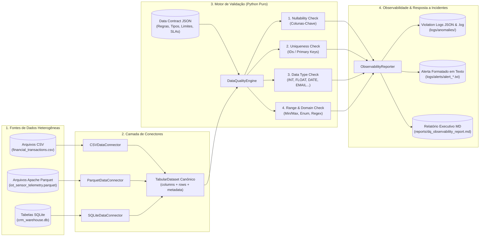
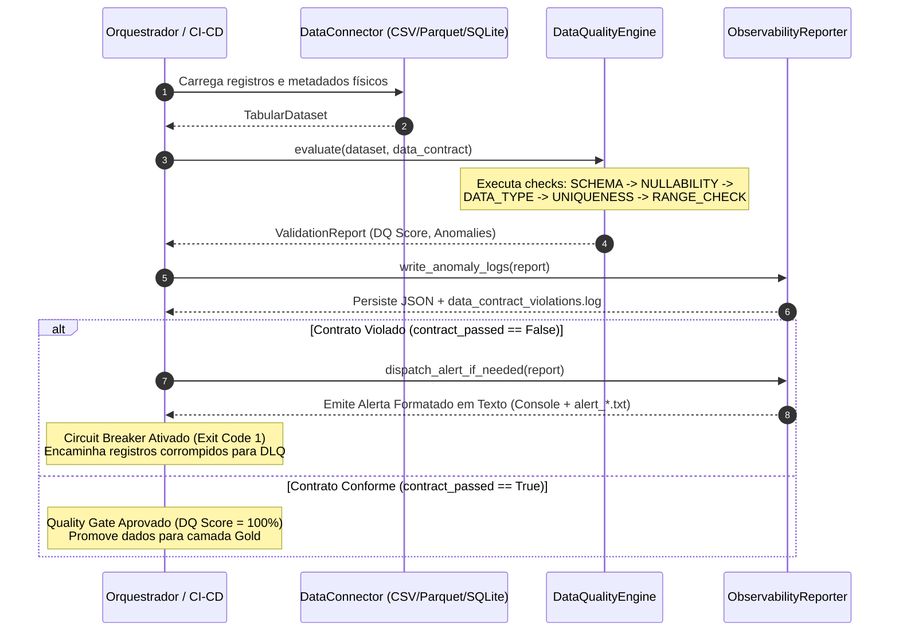

# Data Quality & Observability Framework (CSV, Parquet & SQLite)

Framework modular de **Confiabilidade e Observabilidade de Dados (Data Reliability Engineering — DRE)** desenvolvido em **Python puro** para validação de **Contratos de Dados (Data Contracts)** sobre arquivos **CSV**, **Apache Parquet (`.parquet`)** e tabelas relacionais **SQLite (`.db`)**.

---

## Sumário

1. [Arquitetura de Data Reliability & Data Contracts](#1-arquitetura-de-data-reliability--data-contracts)
2. [Diagramas Conceituais](#2-diagramas-conceituais)
3. [Estrutura do Projeto](#3-estrutura-do-projeto)
4. [Documentação da Suíte de Testes de Data Quality](#4-documentação-da-suíte-de-testes-de-data-quality)
5. [Catálogo de Datasets e Casos de Teste Incluídos](#5-catálogo-de-datasets-e-casos-de-teste-incluídos)
6. [Anatomia do Log de Violação de Contrato e Alerta em Texto](#6-anatomia-do-log-de-violação-de-contrato-e-alerta-em-texto)
7. [Instruções de Execução](#7-instruções-de-execução)

---

## 1. Arquitetura de Data Reliability & Data Contracts

Em arquiteturas modernas de dados, falhas silenciosas — como IDs duplicados por *at-least-once delivery*, mudanças inesperadas de schema, strings infiltradas em colunas numéricas ou valores financeiros negativos — corrompem dashboards executivos e modelos de Machine Learning.

Este framework implementa o padrão **Shift-Left Data Quality Gate** guiado por **Data Contracts declarativos em JSON**:

- **Desacoplamento de Armazenamento (`BaseDataConnector`)**: Conectores dedicados para `CSV`, `Parquet` e `SQLite` convertem os dados brutos para uma estrutura canônica em memória (`TabularDataset`), permitindo que o mesmo motor de regras valide qualquer formato.
- **Classificação de Severidade (`CRITICAL`, `ERROR`, `WARNING`)**: Permite distinguir anomalias que devem acionar um **Circuit Breaker** (interrompendo o pipeline) de alertas não bloqueantes.
- **Rastreabilidade de Linha e Chave Primária**: Cada violação registra o `row_index` exato, a chave primária do registro (`record_pk`), o valor anômalo observado (`observed_value`) e a restrição violada (`expected_constraint`).

---

## 2. Diagramas Conceituais

### 2.1. Arquitetura Modular do Framework



### 2.2. Fluxo de Quality Gate (Circuit Breaker & Dead-Letter Queue)



---

## 3. Estrutura do Projeto

```text
07-data-quality-framework/
├── README.md                               # Documentação completa da arquitetura e suíte de testes
├── run_dq_suite.py                         # Orquestrador principal (executa toda a suíte multi-formato)
├── scripts/
│   └── validate_source.py                  # CLI de Quality Gate para validar qualquer CSV/Parquet/SQLite
├── src/
│   ├── __init__.py
│   ├── config.py                           # Configuração centralizada de diretórios e logging
│   ├── contracts.py                        # Modelo declarativo de Data Contracts e estruturas de relatório
│   ├── connectors.py                       # Conectores modulares para CSV, Apache Parquet e SQLite
│   ├── validators.py                       # Motor de validação em Python puro (Nulos, Unicidade, Range, Tipo)
│   ├── observability.py                    # Gerador de logs de violação de contrato e alertas em texto
│   └── sample_factory.py                   # Gerador de datasets sintéticos e contratos de exemplo
├── tests/
│   ├── __init__.py
│   └── test_dq_framework.py                # Suíte de testes unitários e de integração (unittest)
├── data/                                   # Gerado automaticamente na execução
│   ├── samples/                            # Arquivos CSV, Parquet e banco SQLite de teste
│   └── contracts/                          # Contratos de Dados declarativos em formato JSON
├── logs/
│   ├── anomalies/                          # Logs detalhados de violação (JSON + data_contract_violations.log)
│   └── alerts/                             # Alertas operacionais formatados em texto (.txt)
└── reports/
    └── dq_observability_report.md          # Relatório executivo consolidado em Markdown
```

---

## 4. Documentação da Suíte de Testes de Data Quality

O motor [`DataQualityEngine`](file:///c:/Users/Samir/Downloads/PROJETOS%20PYTHON%20v2/07-data-quality-framework/src/validators.py) executa 5 categorias de validação em cascata para cada coluna especificada no [`DataContract`](file:///c:/Users/Samir/Downloads/PROJETOS%20PYTHON%20v2/07-data-quality-framework/src/contracts.py):

### 4.1. Integridade de Schema (`SCHEMA_CHECK`)
- **`required_columns_exist`**: Verifica se todas as colunas exigidas pelo contrato estão fisicamente presentes no cabeçalho do CSV, no schema colunar do Parquet ou na definição da tabela SQLite.

### 4.2. Nulidade de Colunas-Chave (`NULLABILITY`)
- **`not_null_check`**: Valida colunas marcadas com `nullable=False` ou `is_primary_key=True`.
- Detecta tanto valores `None` e `NaN` nativos quanto representações textuais de nulidade comuns em integrações CSV/SQL (`""`, `"   "`, `"NULL"`, `"null"`, `"None"`, `"NaN"`, `"N/A"`, `"#N/A"`).

### 4.3. Testes de Tipo de Dado e Semântica (`DATA_TYPE`)
- **`type_check_<expected_type>`**: Avalia se o valor (mesmo quando originado de texto em CSV ou coluna com *Type Affinity* `ANY` no SQLite) respeita estritamente o tipo esperado:
  - `INT`: Inteiros exatos (rejeita booleanos, strings alfanuméricas ou floats com casas decimais).
  - `FLOAT`: Números reais finitos (rejeita `NaN`, `Inf` e strings não numéricas).
  - `BOOLEAN`: Valores lógicos (`true/false`, `1/0`, `yes/no`).
  - `DATE`: Datas válidas no calendário civil no padrão ISO-8601 (`YYYY-MM-DD`, rejeitando datas inexistentes como `2026-15-99`).
  - `TIMESTAMP`: Data/hora completa ISO-8601.
  - `EMAIL`: Validação sintática de endereço eletrônico (`usuario@dominio.tld`).
  - `UUID`: Identificador universal de 36 caracteres hexadecimais.

### 4.4. Unicidade de IDs (`UNIQUENESS`)
- **`unique_id_check`**: Mantém um índice hash de valores já observados para colunas com `unique=True` ou `is_primary_key=True`.
- Quando encontra uma chave duplicada, aponta tanto o índice da linha atual quanto o índice exato da primeira ocorrência com a qual colidiu.

### 4.5. Limites de Valores e Domínios (`RANGE_CHECK`)
- **`min_value_bound` & `max_value_bound`**: Verifica se valores numéricos (`INT`/`FLOAT`) estão dentro da janela operacional `[min_value, max_value]`.
- **`allowed_domain_values`**: Verifica se o valor pertence a uma lista fechada de categorias válidas (ex: `currency IN ['BRL', 'USD', 'EUR']`).
- **`regex_pattern_check`**: Valida se strings estruturadas obedecem à expressão regular de negócio (ex: `^TXN-\d{4,}$`).

---

## 5. Catálogo de Datasets e Casos de Teste Incluídos

A fábrica de dados [`sample_factory.py`](file:///c:/Users/Samir/Downloads/PROJETOS%20PYTHON%20v2/07-data-quality-framework/src/sample_factory.py) gera 4 cenários completos cobrindo os 3 formatos exigidos:

| Contrato ID | Fonte / Arquivo | Formato | Registros | Anomalias Injetadas para Teste | Resultado Esperado |
| :--- | :--- | :---: | :---: | :--- | :---: |
| `DC-FIN-CSV-001` | `financial_transactions.csv` | **CSV** | 10 | `TXN-1002` duplicado (`UNIQUENESS`), `customer_id` vazio (`NULLABILITY`), `amount = -450.00` e `risk_score = 145` (`RANGE_CHECK`), `amount = 'ERRO_PARSE_VALOR'` e `transaction_date = '2026-15-99'` (`DATA_TYPE`), `currency = 'DOGE'` e e-mail inválido | **FAIL** (`DQ Score: 50.00%`, 8 violações em 5 linhas) |
| `DC-IOT-PARQUET-002` | `iot_sensor_telemetry.parquet` | **PARQUET** | 8 | `SENS-9002` duplicado (`UNIQUENESS`), `device_id = None` (`NULLABILITY`), `temperature_c = 295.5` e `humidity_pct = 135.0` (`RANGE_CHECK`), `vibration_hz = 'SENSOR_OFFLINE_ERR'` (`DATA_TYPE`) | **FAIL** (`DQ Score: 50.00%`, 5 violações em 4 linhas) |
| `DC-CRM-SQLITE-003` | `crm_warehouse.db::customers_silver` | **SQLITE** | 7 | `CUST-002` duplicado (`UNIQUENESS`), `full_name = NULL` (`NULLABILITY`), `age = -5`, `credit_limit = 950000` e `tier = 'BLACK_INVALID_TIER'` (`RANGE_CHECK`), `age = 'TRINTA_E_DOIS'` (`DATA_TYPE`) | **FAIL** (`DQ Score: 42.86%`, 6 violações em 4 linhas) |
| `DC-CRM-SQLITE-004` | `crm_warehouse.db::customers_gold_clean` | **SQLITE** | 5 | Nenhuma anomalia (tabela Gold saneada e 100% aderente ao contrato) | **PASS** (`DQ Score: 100.00%`, 0 violações) |

---

## 6. Anatomia do Log de Violação de Contrato e Alerta em Texto

Quando um dataset viola o contrato, o framework gera automaticamente:

1. **Log Estruturado em Linha (`logs/anomalies/data_contract_violations.log`):**
   ```text
   2026-11-02T02:18:00.120Z | RUN=DQ-RUN-9A4F12BC | CONTRACT=DC-FIN-CSV-001 | SOURCE=financial_transactions.csv | SEVERITY=CRITICAL | CATEGORY=UNIQUENESS | RULE=unique_id_check | COL=transaction_id | ROW=4 | PK=TXN-1002 | OBSERVED='TXN-1002' | EXPECTED="UNIQUE" | MSG="ID duplicado 'TXN-1002' na coluna 'transaction_id' (linha 4 colide com a linha 2)."
   ```
2. **Alerta Operacional Formatado em Texto (`logs/alerts/alert_financial_transactions_csv.txt`):**
   ```text
   ========================================================================================
    [ALERTA DE CONFIABILIDADE DE DADOS] VIOLAÇÃO DE DATA CONTRACT (CRITICAL)
   ========================================================================================
    Run ID             : DQ-RUN-9A4F12BC
    Contrato Violado   : DC-FIN-CSV-001 (Financial_Transactions_CSV)
    Fonte / Formato    : financial_transactions.csv [CSV]
    Status do Pipeline : BLOQUEADO (CIRCUIT BREAKER ATIVADO - ENVIO PARA DLQ)
   ----------------------------------------------------------------------------------------
   ```

---

## 7. Instruções de Execução

### 7.1. Executar a Suíte Completa (CSV, Parquet e SQLite)

```bash
python 07-data-quality-framework/run_dq_suite.py --clean
```

### 7.2. Validar um Arquivo ou Tabela Específica via CLI (Quality Gate CI/CD)

```bash
# Validar um arquivo CSV contra seu Data Contract JSON
python 07-data-quality-framework/scripts/validate_source.py \
  --format CSV \
  --source 07-data-quality-framework/data/samples/financial_transactions.csv \
  --contract 07-data-quality-framework/data/contracts/contract_financial_transactions.json

# Validar uma tabela SQLite
python 07-data-quality-framework/scripts/validate_source.py \
  --format SQLITE \
  --source 07-data-quality-framework/data/samples/crm_warehouse.db \
  --table customers_gold_clean \
  --contract 07-data-quality-framework/data/contracts/contract_sqlite_customers_gold.json \
  --fail-on-violation
```

### 7.3. Executar a Suíte de Testes Unitários e de Integração

```bash
python 07-data-quality-framework/tests/test_dq_framework.py -v
```
