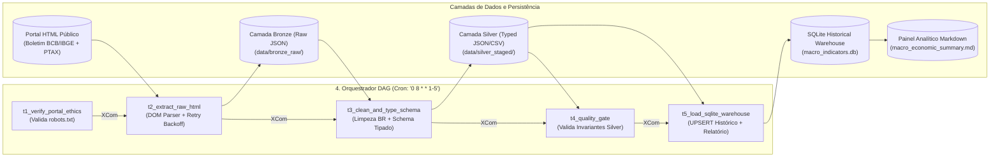
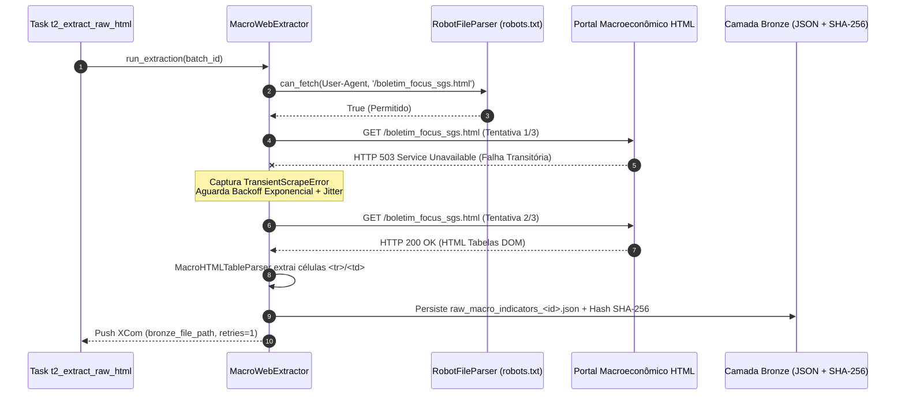
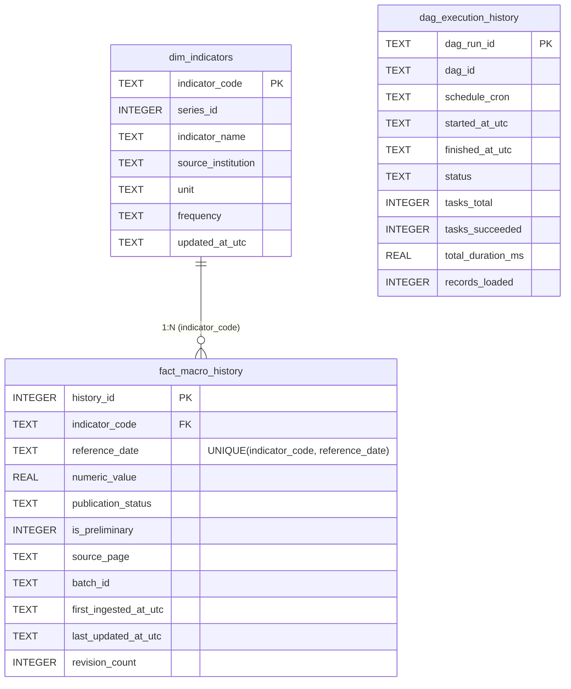

# Web Scraping Ético de Indicadores Macroeconômicos com Orquestrador DAG (Airflow/Cron Simulator)

Projeto de Engenharia de Dados em **Python puro** para extração automatizada, higienização, tipagem forte e armazenamento histórico relacional de indicadores macroeconômicos nacionais (**SELIC**, **IPCA**, **IGP-M**, **Câmbio PTAX USD/BRL e EUR/BRL**, **IBC-Br**, **Taxa de Desemprego PNAD** e **Dívida Bruta/PIB**), coordenado por um **Orquestrador Customizado em DAG Sequencial** inspirado no Apache Airflow.

---

## Sumário

1. [Arquitetura de Web Scraping Ético e Resiliência de Rede](#1-arquitetura-de-web-scraping-ético-e-resiliência-de-rede)
2. [Diagramas Conceituais da Arquitetura](#2-diagramas-conceituais-da-arquitetura)
3. [Estrutura do Projeto](#3-estrutura-do-projeto)
4. [Detalhamento Técnico dos 4 Componentes](#4-detalhamento-técnico-dos-4-componentes)
5. [Modelagem Relacional SQLite e Cálculo de Juro Real (Fisher)](#5-modelagem-relacional-sqlite-e-cálculo-de-juro-real-fisher)
6. [Instruções de Execução](#6-instruções-de-execução)
7. [Suíte de Testes Automatizados](#7-suíte-de-testes-automatizados)

---

## 1. Arquitetura de Web Scraping Ético e Resiliência de Rede

Coletar dados de portais governamentais e instituições financeiras públicas exige responsabilidade operacional e tolerância a falhas transitórias:

1. **Conformidade Ética (`robots.txt` & `User-Agent`)**:
   - Antes de requisitar qualquer página HTML, o extrator interpreta o arquivo `robots.txt` do portal via `urllib.robotparser.RobotFileParser` e valida se o `User-Agent` do robô (`MacroDataEngineeringBot/1.0`) possui permissão explícita para o caminho.
   - Aplica *politeness rate-limiting* entre requisições para jamais sobrecarregar o servidor de origem.
2. **Classificação de Exceções e Retry com Exponential Backoff + Jitter**:
   - **Erros Transitórios (`TransientScrapeError` — HTTP `429`, `500`, `502`, `503`, `504`, `Timeout`)**: Acionam o motor de retentativas com atraso exponencial e *jitter* aleatório para evitar o efeito *Thundering Herd*:
     $$t_{\text{wait}} = \min\left(T_{\max},\; T_{\text{base}} \times 2^{\text{attempt} - 1}\right) + \mathcal{U}(0.01, 0.05)$$
   - **Erros Permanentes (`PermanentScrapeError` / `RobotsTxtDisallowedError` — HTTP `403`, `404`)**: Abortam imediatamente sem desperdiçar retentativas.

---

## 2. Diagramas Conceituais da Arquitetura

### 2.1. Topologia da DAG e Pipeline Medallion (Bronze -> Silver -> Gold Warehouse)



### 2.2. Máquina de Estados do Extrator com Retry Logic



### 2.3. Modelo Entidade-Relacionamento (SQLite Historical Warehouse)



---

## 3. Estrutura do Projeto

```text
08-web-scraping-macro/
├── README.md                           # Documentação técnica completa do projeto
├── run_dag.py                          # Ponto de entrada principal do Orquestrador DAG
├── scripts/
│   ├── 1_extractor.py                  # Script 1: Extrator Web Scraping com Retry Logic
│   ├── 2_transformer.py                # Script 2: Limpeza, normalização e Schema Tipado
│   ├── 3_loader.py                     # Script 3: Carga histórica relacional no SQLite
│   └── 4_dag_orchestrator.py           # Script 4: Simulador de Orquestração em DAG Sequencial
├── src/
│   ├── __init__.py
│   ├── config.py                       # Configurações de rede, User-Agent, Backoff e diretórios
│   ├── portal_simulator.py             # Gerador de páginas HTML5 macroeconômicas e robots.txt
│   ├── extractor.py                    # Parser DOM HTML nativo, RobotFileParser e Retry Engine
│   ├── transformer.py                  # Conversão numérica BR, datas ISO, quarentena e tipagem
│   ├── loader.py                       # DDL SQLite, UPSERT histórico, Views SQL e relatório
│   └── dag_orchestrator.py             # Motor DAG (Kahn Topological Sort, XCom, TaskState)
├── tests/
│   ├── __init__.py
│   └── test_macro_pipeline.py          # Testes unitários e de integração fim-a-fim
├── data/                               # Gerado automaticamente durante a execução
│   ├── mock_portal_html/               # Páginas HTML5 e robots.txt inspecionados pelo scraper
│   ├── bronze_raw/                     # Payloads JSON brutos extraídos + SHA-256
│   ├── silver_staged/                  # Registros limpos e estritamente tipados (JSON e CSV)
│   └── warehouse/
│       └── macro_indicators.db         # Banco de dados relacional histórico SQLite
├── logs/
│   └── latest_dag_run.json             # Telemetria detalhada da execução da DAG e XCom
└── reports/
    └── macro_economic_summary.md       # Relatório analítico com Juro Real (Equação de Fisher)
```

---

## 4. Detalhamento Técnico dos 4 Componentes

### 1. Extrator Robusto (`src/extractor.py` & `scripts/1_extractor.py`)
- Implementa [`MacroWebExtractor`](file:///c:/Users/Samir/Downloads/PROJETOS%20PYTHON%20v2/08-web-scraping-macro/src/extractor.py#L121-L266) e [`MacroHTMLTableParser`](file:///c:/Users/Samir/Downloads/PROJETOS%20PYTHON%20v2/08-web-scraping-macro/src/extractor.py#L67-L118) (baseado em `html.parser.HTMLParser` da biblioteca padrão).
- Possui injeção configurável de falha transitória (`--simulate-failures 1`) que simula um erro `HTTP 503 Service Unavailable` na primeira requisição, demonstrando em tempo real o log de **Exponential Backoff + Jitter** e a recuperação automática na tentativa subsequente.

### 2. Transformador e Schema Tipado (`src/transformer.py` & `scripts/2_transformer.py`)
- Implementa [`MacroDataTransformer`](file:///c:/Users/Samir/Downloads/PROJETOS%20PYTHON%20v2/08-web-scraping-macro/src/transformer.py#L64-L246) que converte células brutas de HTML para o dataclass fortemente tipado [`TypedMacroIndicator`](file:///c:/Users/Samir/Downloads/PROJETOS%20PYTHON%20v2/08-web-scraping-macro/src/transformer.py#L31-L47):
  - Remove notas de rodapé e sufixos (`(*)`, `[1]`, `[preliminar]`, `% a.a.`, `R$`, `pts`, `do PIB`).
  - Converte decimais brasileiros (`"10,75% a.a. (*)"` $\rightarrow$ `10.75`, `"R$ 5,7450"` $\rightarrow$ `5.745`).
  - Padroniza datas heterogêneas (`"01/11/2026"` e `"2026-11-01"`) para `YYYY-MM-DD`.
  - Isola linhas não divulgadas (`"N/D (*)"`) em quarentena documentada sem interromper as séries válidas.

### 3. Carregador Histórico SQLite (`src/loader.py` & `scripts/3_loader.py`)
- Implementa [`MacroWarehouseLoader`](file:///c:/Users/Samir/Downloads/PROJETOS%20PYTHON%20v2/08-web-scraping-macro/src/loader.py#L107-L299) sobre o banco `macro_indicators.db`.
- Executa `UPSERT` idempotente em `fact_macro_history` usando a chave natural composta `UNIQUE(indicator_code, reference_date)`:
  - Se um indicador já existente receber uma revisão (ex: de `PRELIMINAR` para `DEFINITIVO`), o valor é atualizado, `first_ingested_at_utc` é preservado e `revision_count` é incrementado automaticamente.

### 4. Simulador de Orquestração em DAG (`src/dag_orchestrator.py` & `run_dag.py`)
- Implementa um motor completo de **Directed Acyclic Graph (DAG)** em Python puro ([`DAG`](file:///c:/Users/Samir/Downloads/PROJETOS%20PYTHON%20v2/08-web-scraping-macro/src/dag_orchestrator.py#L108-L263) e [`PythonTask`](file:///c:/Users/Samir/Downloads/PROJETOS%20PYTHON%20v2/08-web-scraping-macro/src/dag_orchestrator.py#L68-L91)):
  - Suporta encadeamento via operador `>>` (`t1 >> t2 >> t3 >> t4 >> t5`).
  - Executa ordenação topológica via **Algoritmo de Kahn** e bloqueia grafos cíclicos (`DAGCycleError`).
  - Propaga metadados entre tarefas via `XCom` (`ctx.xcom_push` / `ctx.xcom_pull`) e propaga o estado `UPSTREAM_FAILED` caso qualquer tarefa anterior falhe após suas retentativas.

---

## 5. Modelagem Relacional SQLite e Cálculo de Juro Real (Fisher)

Além de armazenar as séries históricas, o banco SQLite disponibiliza a view analítica `vw_brazil_real_interest_rate`, que cruza automaticamente a série `SELIC_META` com `IPCA_ACUM_12M` e calcula a **Taxa de Juros Real Ex-Post** pela Equação Exata de Fisher:

$$r_{\text{real}} = \left(\frac{1 + \frac{\text{SELIC}}{100}}{1 + \frac{\text{IPCA}_{12\text{m}}}{100}} - 1\right) \times 100$$

---

## 6. Instruções de Execução

### Opção A: Executar a DAG Completa via Orquestrador (Recomendado)

```bash
python 08-web-scraping-macro/run_dag.py --clean --simulate-failures 1
```

Também pode ser invocado pelo script numerado 4:

```bash
python 08-web-scraping-macro/scripts/4_dag_orchestrator.py --clean --simulate-failures 1
```

### Opção B: Executar cada Etapa Individualmente (Scripts 1, 2 e 3)

```bash
# 1. Extração Web Scraping Ético (gera JSON bruto na camada Bronze)
python 08-web-scraping-macro/scripts/1_extractor.py --simulate-failures 1

# 2. Limpeza, Normalização e Schema Tipado (gera JSON e CSV na camada Silver)
python 08-web-scraping-macro/scripts/2_transformer.py

# 3. Carga Histórica Relacional no SQLite e geração do Relatório Analítico
python 08-web-scraping-macro/scripts/3_loader.py
```

---

## 7. Suíte de Testes Automatizados

Para executar os testes unitários e de integração (validação de `robots.txt`, recuperação de falha transitória HTTP 503 via Exponential Backoff, parsing numérico brasileiro, detecção de ciclo na DAG, propagação de `UPSTREAM_FAILED` e idempotência de `UPSERT` no SQLite):

```bash
python 08-web-scraping-macro/tests/test_macro_pipeline.py -v
```
