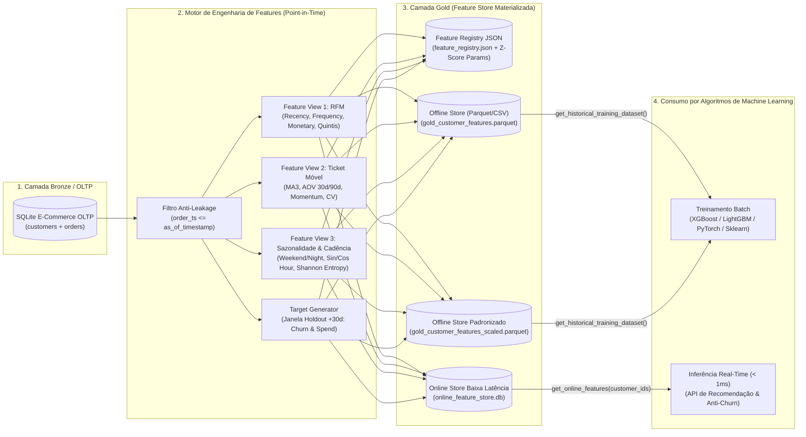
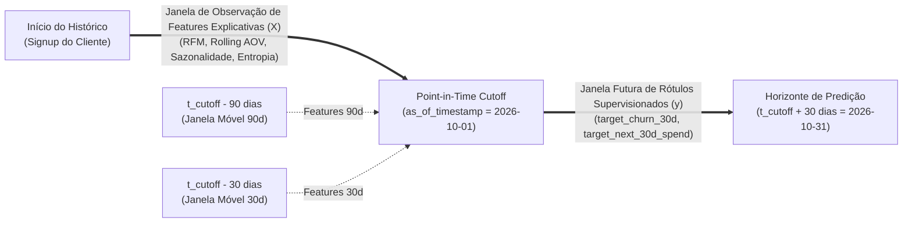

# Feature Store para Machine Learning em Arquitetura de Dados (Camada Gold)

Implementação de uma **Feature Store Local (Dual-Layer: Offline & Online Store + Feature Registry)** em Python para engenharia de features preditivas sobre dados transacionais de e-commerce. O projeto aplica garantias de **Point-in-Time Correctness (Anti-Data Leakage)** e materializa vetores prontos para consumo por algoritmos de Machine Learning (predição de **Churn**, **Customer Lifetime Value — CLV** e **Segmentação Comportamental**).

---

## Sumário

1. [Arquitetura da Feature Store (Medallion Gold Layer)](#1-arquitetura-da-feature-store-medallion-gold-layer)
2. [Diagramas Conceituais da Arquitetura](#2-diagramas-conceituais-da-arquitetura)
3. [Formulação Matemática das Features Avançadas](#3-formulação-matemática-das-features-avançadas)
4. [Dicionário Completo de Dados das Features (Camada Gold)](#4-dicionário-completo-de-dados-das-features-camada-gold)
5. [Estrutura do Projeto](#5-estrutura-do-projeto)
6. [Instruções de Execução e Uso das APIs](#6-instruções-de-execução-e-uso-das-apis)
7. [Suíte de Testes Automatizados](#7-suíte-de-testes-automatizados)

---

## 1. Arquitetura da Feature Store (Medallion Gold Layer)

Em sistemas de Machine Learning em produção, dois problemas clássicos comprometem a confiabilidade dos modelos:
1. **Data Leakage (Vazamento Temporal)**: Calcular agregações históricas incluindo acidentalmente eventos que ocorreram *após* o instante de decisão do modelo.
2. **Training-Serving Skew**: Treinar o modelo cientificamente em notebooks usando uma lógica de SQL/Pandas e reescrever outra lógica diferente na API de produção para inferência em tempo real.

Esta **Feature Store** resolve ambos os problemas através de:
- **Corte Temporal Estrito (`as_of_timestamp`)**: Todas as variáveis explicativas ($X$) são computadas exclusivamente com transações onde $t_{\text{order}} \le t_{\text{cutoff}}$, enquanto as variáveis resposta ($y$: `target_churn_30d` e `target_next_30d_spend`) são extraídas da janela futura $(t_{\text{cutoff}}, t_{\text{cutoff}} + 30\text{ dias}]$.
- **Materialização Dupla Sincronizada (Camada Gold)**:
  - **Offline Feature Store (`Parquet` + `Z-Score Scaled Parquet` + `CSV`)**: Armazenamento colunar comprimido ideal para leitura vetorial rápida durante treinamento em lote (*Batch Training*), validação cruzada e *backtesting*. Inclui uma versão pré-padronizada via **Z-Score** ($\mu=0, \sigma=1$) para consumo imediato por Regressão Logística, Redes Neurais, SVM e K-Means.
  - **Online Feature Store (`SQLite Key-Value & Indexed Table`)**: Armazenamento indexado por chave primária (`customer_id`) com latência sub-milissegundo ($< 1\text{ ms}$) para servir predições em tempo real (*Online Inference*).
  - **Feature Registry (`feature_registry.json`)**: Catálogo centralizado contendo linhagem, *Feature Views* e os parâmetros exatos ($\mu, \sigma, \min, \max$) do escalonador Z-Score.

---

## 2. Diagramas Conceituais da Arquitetura

### 2.1. Arquitetura Dual-Layer da Feature Store (Offline & Online Serving)



### 2.2. Janela Temporal Point-in-Time Correctness (Prevenção de Data Leakage)



---

## 3. Formulação Matemática das Features Avançadas

### 3.1. RFM e Índice Composto Ponderado
Para cada cliente $i$ no instante de corte $t_{\text{cutoff}}$:
- **Recência ($R_i$)**: $R_i = \frac{t_{\text{cutoff}} - \max_{k}(t_{i,k})}{86400}$ (em dias).
- **Frequência ($F_i$)**: Contagem de pedidos concluídos até $t_{\text{cutoff}}$ (total, últimos $30\text{d}$ e $90\text{d}$).
- **Valor Monetário ($M_i$)**: Soma líquida $\sum_{k=1}^{F_i} \text{net\_amount}_{i,k}$.
- **Índice Composto RFM**: A partir dos escores de quintil $S_R, S_F, S_M \in \{1, 2, 3, 4, 5\}$:
  $$\text{RFM}_{\text{score}} = 0.35 \cdot S_R + 0.35 \cdot S_F + 0.30 \cdot S_M$$

### 3.2. Ticket Médio Móvel, Momentum e Volatilidade
- **Ticket Médio Móvel das Últimas 3 Compras ($\text{MA}_3$)**:
  $$\text{MA}_{3, i} = \frac{1}{\min(3, F_i)} \sum_{k = F_i - \min(3, F_i) + 1}^{F_i} \text{net\_amount}_{i,k}$$
- **Razão de Momentum de Gasto ($\text{Momentum}_i$)**: Captura se o cliente está expandindo ($> 1.0$) ou contraindo ($< 1.0$) sua cesta recente em relação à sua média histórica ($\text{AOV}_{\text{lifetime}}$):
  $$\text{Momentum}_i = \frac{\text{MA}_{3, i}}{\text{AOV}_{\text{lifetime}, i}}$$
- **Coeficiente de Variação do Ticket ($CV_i$)**: Mede a dispersão relativa dos gastos:
  $$CV_i = \frac{\sigma_{\text{ticket}, i}}{\text{AOV}_{\text{lifetime}, i}}$$

### 3.3. Sazonalidade Cíclica, Cadência Inter-Compra e Entropia de Shannon
- **Codificação Trigonométrica do Horário de Compra (`peak_hour_sin`, `peak_hour_cos`)**: Preserva a continuidade topológica do relógio de 24 horas ($23\text{h}59$ é vizinho imediato de $00\text{h}00$):
  $$\overline{\sin(h)}_i = \frac{1}{F_i}\sum_{k=1}^{F_i} \sin\left(\frac{2\pi \cdot h_{i,k}}{24}\right), \quad \overline{\cos(h)}_i = \frac{1}{F_i}\sum_{k=1}^{F_i} \cos\left(\frac{2\pi \cdot h_{i,k}}{24}\right)$$
- **Índice de Atraso de Cadência (`overdue_cadence_ratio`)**: Quantos ciclos naturais de recompra o cliente já ultrapassou sem comprar (principal preditor individual de Churn):
  $$\text{Overdue}_i = \frac{\text{Recência}_i}{\max\left(1.0,\; \mu_{\Delta t, i}\right)}, \quad \text{onde } \mu_{\Delta t, i} = \frac{1}{F_i - 1}\sum_{k=2}^{F_i} (t_{i,k} - t_{i,k-1})$$
- **Entropia de Shannon de Diversidade de Categorias ($H_i$)**: Mede a variedade de departamentos explorados pelo cliente:
  $$H_i = -\sum_{c \in \mathcal{C}} p_{i,c} \log_2(p_{i,c})$$

---

## 4. Dicionário Completo de Dados das Features (Camada Gold)

| # | Nome da Coluna | Tipo | Feature View | Descrição Técnica e Interpretação Preditiva |
| :-: | :--- | :---: | :---: | :--- |
| 1 | `customer_id` | `STRING` | Entity Key | Identificador único global do cliente (`CUST-0001`). |
| 2 | `as_of_timestamp` | `STRING` | Point-in-Time | Timestamp ISO-8601 de corte temporal anti-leakage. |
| 3 | `state_uf` | `STRING` | Demográfico | Unidade Federativa de residência do cliente. |
| 4 | `acquisition_channel` | `STRING` | Demográfico | Canal de aquisição original (`ORGANIC_SEARCH`, `PAID_SOCIAL`, etc.). |
| 5 | `tenure_days` | `INT` | Demográfico | Idade da conta do cliente em dias até `as_of_timestamp`. |
| 6 | `rfm_recency_days` | `FLOAT` | `rfm_view` | Dias corridos desde a última compra concluída até o cutoff. |
| 7 | `rfm_frequency_total` | `INT` | `rfm_view` | Total histórico de pedidos concluídos pelo cliente. |
| 8 | `rfm_frequency_30d` | `INT` | `rfm_view` | Quantidade de pedidos concluídos nos últimos 30 dias. |
| 9 | `rfm_frequency_90d` | `INT` | `rfm_view` | Quantidade de pedidos concluídos nos últimos 90 dias. |
| 10 | `rfm_monetary_total` | `FLOAT` | `rfm_view` | Valor monetário líquido acumulado (LTV histórico em R$). |
| 11 | `rfm_monetary_30d` | `FLOAT` | `rfm_view` | Gasto líquido acumulado nos últimos 30 dias (R$). |
| 12 | `rfm_monetary_90d` | `FLOAT` | `rfm_view` | Gasto líquido acumulado nos últimos 90 dias (R$). |
| 13 | `rfm_r_score` | `INT` | `rfm_view` | Quintil de Recência ($1$ a $5$, onde $5$ = comprou mais recentemente). |
| 14 | `rfm_f_score` | `INT` | `rfm_view` | Quintil de Frequência ($1$ a $5$, onde $5$ = maior frequência). |
| 15 | `rfm_m_score` | `INT` | `rfm_view` | Quintil de Valor Monetário ($1$ a $5$, onde $5$ = maior gasto). |
| 16 | `rfm_composite_score` | `FLOAT` | `rfm_view` | Média ponderada dos quintis ($0.35 R + 0.35 F + 0.30 M$). |
| 17 | `rfm_segment` | `STRING` | `rfm_view` | Segmento comportamental (`CHAMPIONS`, `LOYAL_CUSTOMERS`, `AT_RISK`, `HIBERNATING`). |
| 18 | `aov_lifetime` | `FLOAT` | `rolling_ticket_view` | Ticket médio histórico global ($\text{Monetary} / \text{Frequency}$). |
| 19 | `rolling_aov_last_3` | `FLOAT` | `rolling_ticket_view` | Ticket médio móvel calculado sobre as últimas 3 transações ($\text{MA}_3$). |
| 20 | `rolling_aov_30d` | `FLOAT` | `rolling_ticket_view` | Ticket médio móvel dentro da janela de 30 dias. |
| 21 | `rolling_aov_90d` | `FLOAT` | `rolling_ticket_view` | Ticket médio móvel dentro da janela de 90 dias. |
| 22 | `aov_momentum_ratio` | `FLOAT` | `rolling_ticket_view` | Razão $\text{rolling\_aov\_last\_3} / \text{aov\_lifetime}$ (aceleração/desaceleração de ticket). |
| 23 | `ticket_stddev` | `FLOAT` | `rolling_ticket_view` | Desvio padrão ($\sigma$) do valor dos pedidos do cliente. |
| 24 | `ticket_cv` | `FLOAT` | `rolling_ticket_view` | Coeficiente de Variação ($\sigma / \mu$) do ticket do cliente. |
| 25 | `avg_items_per_order` | `FLOAT` | `rolling_ticket_view` | Média de itens por cesta de compra. |
| 26 | `weekend_purchase_ratio` | `FLOAT` | `seasonality_view` | Proporção de compras realizadas aos sábados e domingos ($0.0$ a $1.0$). |
| 27 | `night_purchase_ratio` | `FLOAT` | `seasonality_view` | Proporção de compras realizadas no período noturno (20h às 06h). |
| 28 | `peak_hour_sin` | `FLOAT` | `seasonality_view` | Componente Seno do horário médio de compra ($\in [-1, 1]$). |
| 29 | `peak_hour_cos` | `FLOAT` | `seasonality_view` | Componente Cosseno do horário médio de compra ($\in [-1, 1]$). |
| 30 | `dominant_quarter` | `STRING` | `seasonality_view` | Trimestre sazonal modal de compras do cliente (`Q1`, `Q2`, `Q3`, `Q4`). |
| 31 | `avg_interpurchase_days` | `FLOAT` | `seasonality_view` | Intervalo médio em dias entre compras consecutivas ($\mu_{\Delta t}$). |
| 32 | `stddev_interpurchase_days` | `FLOAT` | `seasonality_view` | Desvio padrão do intervalo entre compras ($\sigma_{\Delta t}$). |
| 33 | `overdue_cadence_ratio` | `FLOAT` | `seasonality_view` | Razão $\text{rfm\_recency\_days} / \text{avg\_interpurchase\_days}$ (alerta de Churn). |
| 34 | `category_shannon_entropy` | `FLOAT` | `seasonality_view` | Entropia de Shannon (em bits) da diversidade de categorias compradas. |
| 35 | `distinct_categories_count` | `INT` | `seasonality_view` | Quantidade de categorias distintas já compradas pelo cliente. |
| 36 | `discount_usage_rate` | `FLOAT` | `seasonality_view` | Fração de pedidos realizados com cupom/desconto promocional. |
| 37 | `avg_discount_depth_pct` | `FLOAT` | `seasonality_view` | Percentual médio de desconto obtido nas compras. |
| 38 | `pix_payment_share` | `FLOAT` | `seasonality_view` | Participação do método PIX nos pagamentos concluídos. |
| 39 | `cancellation_rate` | `FLOAT` | `seasonality_view` | Taxa de pedidos cancelados/estornados sobre o total tentado. |
| 40 | `target_churn_30d` | `INT` | `targets_view` | **Label de Classificação**: `1` se não comprou nos 30 dias pós-cutoff, `0` caso contrário. |
| 41 | `target_next_30d_spend` | `FLOAT` | `targets_view` | **Label de Regressão**: Valor líquido gasto nos 30 dias pós-cutoff (R$). |

---

## 5. Estrutura do Projeto

```text
09-feature-store-ml/
├── README.md                                   # Documentação arquitetural e dicionário de features
├── run_feature_store.py                        # Orquestrador End-to-End da Feature Store
├── scripts/
│   └── query_features.py                       # CLI para consulta de vetores na Online Feature Store
├── src/
│   ├── __init__.py
│   ├── config.py                               # Configurações de diretórios e Point-in-Time Cutoff
│   ├── oltp_seeder.py                          # Gerador transacional de E-Commerce (SQLite OLTP)
│   ├── feature_engineering.py                  # Cálculo de RFM, Ticket Móvel, Sazonalidade e Entropia
│   └── feature_store.py                        # Camada Gold (Offline Parquet/Z-Score + Online Store KV)
├── tests/
│   ├── __init__.py
│   └── test_feature_store.py                   # Testes automatizados (Anti-Leakage, Fórmulas e Serving)
├── data/                                       # Gerado automaticamente na execução
│   ├── bronze_oltp/
│   │   └── ecommerce_oltp.db                   # Base transacional bruta (customers + orders)
│   └── gold_feature_store/
│       ├── gold_customer_features.parquet      # Offline Store Colunar (valores originais)
│       ├── gold_customer_features_scaled.parquet # Offline Store Padronizado (Z-Score para ML)
│       ├── gold_customer_features.csv          # Exportação CSV para inspeção rápida
│       ├── online_feature_store.db             # Online Store SQLite (Key-Value < 1ms)
│       └── feature_registry.json               # Catálogo de metadados e parâmetros Z-Score
└── reports/
    └── feature_store_ml_report.md              # Relatório de correlação de Pearson e perfil RFM
```

---

## 6. Instruções de Execução e Uso das APIs

### 6.1. Materializar a Feature Store Completa (End-to-End)

```bash
python 09-feature-store-ml/run_feature_store.py --clean --customers 60
```

### 6.2. Consultar Features em Tempo Real via CLI (Online Store)

```bash
python 09-feature-store-ml/scripts/query_features.py \
  --customer-ids CUST-0001 CUST-0004 \
  --features rfm_segment rfm_recency_days rolling_aov_last_3 aov_momentum_ratio overdue_cadence_ratio
```

### 6.3. Consumir em Scripts de Treinamento ou Inferência Python

```python
from src.feature_store import LocalFeatureStore

store = LocalFeatureStore()

# 1. Treinamento Batch (Offline Store com features padronizadas via Z-Score)
training_rows = store.get_historical_training_dataset(scaled=True)

# 2. Inferência Online de Baixa Latência (< 1ms por lote de entidades)
online_vectors = store.get_online_features(
    customer_ids=["CUST-0001", "CUST-0002"],
    feature_names=["rfm_recency_days", "rolling_aov_last_3", "overdue_cadence_ratio"],
)
```

---

## 7. Suíte de Testes Automatizados

Para validar matematicamente as fórmulas de RFM, Ticket Médio Móvel, Entropia de Shannon, a proteção contra *Data Leakage* (*Point-in-Time Correctness*) e a paridade entre *Offline* e *Online Store*:

```bash
python 09-feature-store-ml/tests/test_feature_store.py -v
```
