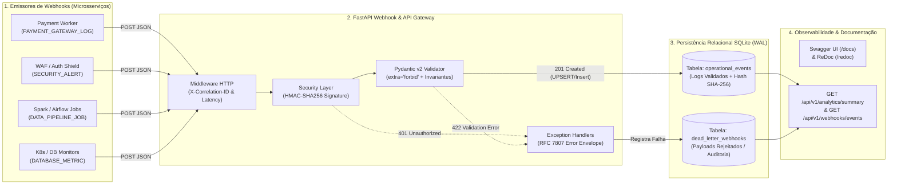
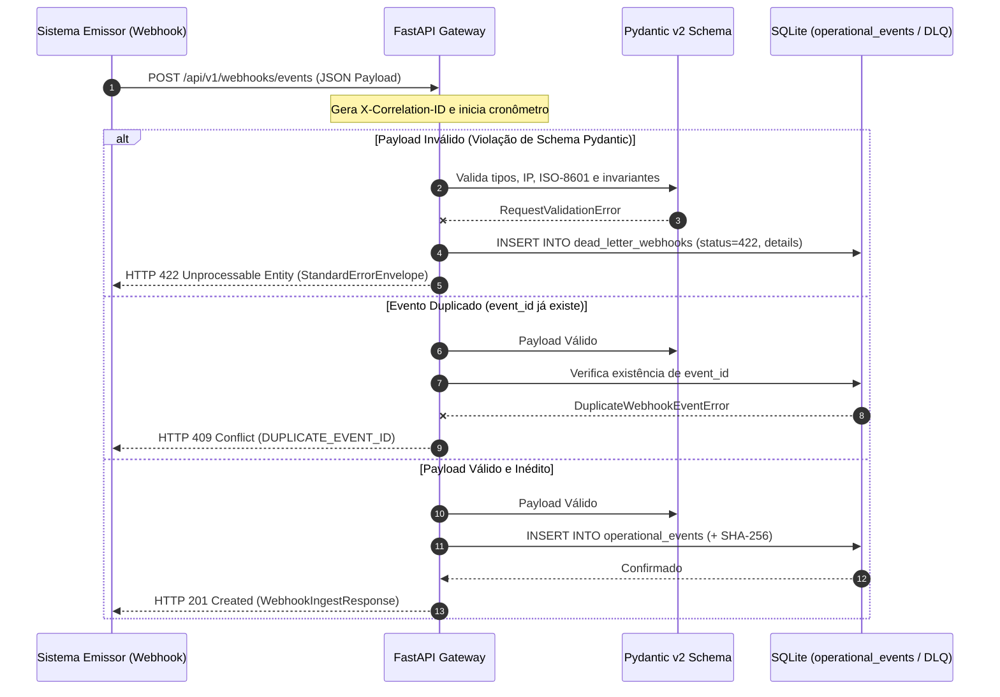

# Webhook & API Gateway de Logs Operacionais com FastAPI e Pydantic v2

API de alta performance desenvolvida com **FastAPI**, **Pydantic v2** e **SQLite Relacional (WAL Mode)** que atua como um **Receptor Central de Webhooks e API Gateway de Logs Operacionais**. O serviço valida rigorosamente payloads de eventos de microsserviços, aplica autenticação criptográfica **HMAC-SHA256**, garante **idempotência transacional**, isola payloads malformados em uma **Dead-Letter Queue (DLQ)** e expõe documentação interativa automática via **Swagger UI (`/docs`)**.

---

## Sumário

1. [Arquitetura do API Gateway e Ingestão de Webhooks](#1-arquitetura-do-api-gateway-e-ingestão-de-webhooks)
2. [Diagramas Conceituais](#2-diagramas-conceituais)
3. [Estrutura do Projeto](#3-estrutura-do-projeto)
4. [Especificação do Contrato Pydantic v2 e Regras de Validação](#4-especificação-do-contrato-pydantic-v2-e-regras-de-validação)
5. [Catálogo de Endpoints (Swagger UI / OpenAPI)](#5-catálogo-de-endpoints-swagger-ui--openapi)
6. [Exemplos Práticos de Requisições `curl`](#6-exemplos-práticos-de-requisições-curl)
7. [Como Executar o Servidor, a Simulação e os Testes (`pytest`)](#7-como-executar-o-servidor-a-simulação-e-os-testes-pytest)

---

## 1. Arquitetura do API Gateway e Ingestão de Webhooks

Em arquiteturas distribuídas orientadas a eventos, um **Webhook Gateway** precisa proteger a camada de armazenamento analítico contra dados corrompidos, picos de retentativas duplicadas e requisições não autorizadas:

- **Validação Estrita com Pydantic v2 (`ConfigDict(extra="forbid")`)**: Qualquer campo não previsto no schema oficial é imediatamente rejeitado com `422 Unprocessable Entity`, prevenindo poluição silenciosa de schema (*Schema Drift*).
- **Invariantes Semânticas e Cruzadas (`@field_validator` & `@model_validator`)**: Valida sintaxe de endereços IPv4/IPv6 (`ipaddress`), timestamps ISO-8601, limites físicos de telemetria (CPU `0..100%`, latência $\ge 0$) e exige obrigatoriamente `trace_id` quando `severity == "CRITICAL"` ou `event_type == "SECURITY_ALERT"`.
- **Dead-Letter Queue (DLQ) Automática**: Sempre que um payload falha na validação Pydantic (`422`) ou na verificação de assinatura HMAC (`401`), o *Exception Handler* customizado grava o payload bruto e o diagnóstico do erro na tabela relacional `dead_letter_webhooks` para auditoria de Engenharia de Dados.
- **Idempotência Nativa**: Reenvios acidentais do mesmo `event_id` são interceptados pela chave primária relacional, retornando `409 Conflict` no endpoint unitário ou sendo deduplicados com segurança no endpoint em lote (`/batch`).

---

## 2. Diagramas Conceituais

### 2.1. Fluxo Arquitetural do FastAPI Webhook Gateway



### 2.2. Diagrama de Sequência: Recepção, Validação e Tratamento de Erros



---

## 3. Estrutura do Projeto

```text
10-webhook-api-fastapi/
├── README.md                           # Documentação técnica e guia de requisições curl
├── requirements.txt                    # Dependências (fastapi, pydantic, uvicorn, httpx, pytest)
├── run_gateway_demo.py                 # Simulador de tráfego e gerador de relatório operacional
├── src/
│   ├── __init__.py
│   ├── config.py                       # Configurações do API Gateway, banco SQLite e segredo HMAC
│   ├── schemas.py                      # Contratos Pydantic v2 estritos e envelopes de resposta
│   ├── database.py                     # Repositório relacional SQLite (eventos + Dead-Letter Queue)
│   ├── security.py                     # Cálculo e validação criptográfica HMAC-SHA256
│   └── main.py                         # Aplicação FastAPI, middlewares, rotas e exception handlers
├── tests/
│   ├── __init__.py
│   └── test_webhook_api.py             # Suíte de testes automatizados com pytest (6 cenários)
├── data/                               # Gerado automaticamente em tempo de execução
│   └── operational_logs_gateway.db     # Banco relacional SQLite em modo WAL
└── reports/
    └── gateway_operational_report.md   # Relatório operacional consolidado
```

---

## 4. Especificação do Contrato Pydantic v2 e Regras de Validação

O schema [`WebhookEventCreate`](file:///c:/Users/Samir/Downloads/PROJETOS%20PYTHON%20v2/10-webhook-api-fastapi/src/schemas.py#L76-L214) aplica as seguintes regras:

| Campo | Tipo | Obrigatório | Regra de Validação Estrita |
| :--- | :---: | :---: | :--- |
| `event_id` | `str` | Sim | Regex `^EVT-[A-Za-z0-9_-]{4,64}$` (Chave Primária de Idempotência). |
| `event_type` | `Enum` | Sim | `DEPLOY_EVENT`, `SECURITY_ALERT`, `DATABASE_METRIC`, `PAYMENT_GATEWAY_LOG`, `DATA_PIPELINE_JOB`, `APPLICATION_ERROR`. |
| `severity` | `Enum` | Sim | `DEBUG`, `INFO`, `WARNING`, `ERROR`, `CRITICAL`. |
| `environment` | `Enum` | Sim | `PRODUCTION`, `STAGING`, `DEVELOPMENT`. |
| `service_name` | `str` | Sim | Kebab/snake-case minúsculo `^[a-z0-9][a-z0-9_-]{2,63}$`. |
| `host_ip` | `str` | Sim | Endereço IPv4 ou IPv6 válido verificado via módulo `ipaddress`. |
| `trace_id` | `Optional[str]` | Condicional | **Obrigatório** caso `severity == "CRITICAL"` ou `event_type == "SECURITY_ALERT"`. |
| `event_timestamp_utc` | `str` | Sim | Data/hora ISO-8601 válida. |
| `message` | `str` | Sim | Entre 5 e 2.000 caracteres. |
| `metrics.latency_ms` | `float` | Sim | Entre `0.0` e `600000.0` ms. |
| `metrics.cpu_usage_pct` | `Optional[float]` | Não | Entre `0.0` e `100.0`%. |
| `metrics.http_status_code` | `Optional[int]` | Não | Código HTTP válido entre `100` e `599`. |

---

## 5. Catálogo de Endpoints (Swagger UI / OpenAPI)

Com o servidor em execução, acesse:
- **Swagger UI Interativo:** `http://127.0.0.1:8000/docs`
- **ReDoc Documentation:** `http://127.0.0.1:8000/redoc`
- **Especificação OpenAPI JSON:** `http://127.0.0.1:8000/openapi.json`

| Método | Rota | Status Sucesso | Descrição |
| :---: | :--- | :---: | :--- |
| `GET` | `/health` | `200 OK` | Verifica saúde da API, modo WAL do SQLite e contagem de eventos. |
| `POST` | `/api/v1/webhooks/events` | `201 Created` | Recebe, valida e persiste um único evento de Webhook. |
| `POST` | `/api/v1/webhooks/events/batch` | `201 Created` | Recebe e persiste um lote de até 100 eventos com deduplicação. |
| `GET` | `/api/v1/webhooks/events` | `200 OK` | Consulta paginada com filtros (`service_name`, `severity`, `event_type`, `environment`). |
| `GET` | `/api/v1/webhooks/events/{event_id}` | `200 OK` | Recupera o registro completo de um evento pelo `event_id`. |
| `GET` | `/api/v1/analytics/summary` | `200 OK` | Retorna estatísticas de latência, CPU, contagem por severidade e DLQ. |
| `GET` | `/api/v1/dead-letter-queue` | `200 OK` | Lista os payloads inválidos bloqueados pelo gateway. |

---

## 6. Exemplos Práticos de Requisições `curl`

### 6.1. Health Check do Gateway
```bash
curl -X GET "http://127.0.0.1:8000/health" -H "accept: application/json"
```

### 6.2. Enviar um Evento de Webhook Válido (`201 Created`)
```bash
curl -X POST "http://127.0.0.1:8000/api/v1/webhooks/events" \
  -H "Content-Type: application/json" \
  -H "X-Correlation-ID: corr-demo-001" \
  -d '{
    "event_id": "EVT-20261102-9001",
    "event_type": "PAYMENT_GATEWAY_LOG",
    "severity": "INFO",
    "environment": "PRODUCTION",
    "service_name": "pix-settlement-worker",
    "host_ip": "10.24.18.105",
    "trace_id": "trc-8f92a1c4b7e01923",
    "event_timestamp_utc": "2026-11-02T09:50:15.120Z",
    "message": "Liquidacao de transacao PIX processada com sucesso no SPI.",
    "metrics": {
      "latency_ms": 38.4,
      "cpu_usage_pct": 41.2,
      "memory_mb": 384.0,
      "http_status_code": 200
    },
    "tags": ["pix", "spi", "settlement"],
    "payload_context": {
      "bank_ispb": "18236120",
      "tx_count": 1
    }
  }'
```

### 6.3. Testar Validação Rígida e Dead-Letter Queue (`422 Unprocessable Entity`)
Enviando um IP inválido (`999.999.999.999`), latência negativa (`-10.0`) e severidade `CRITICAL` sem `trace_id`:
```bash
curl -X POST "http://127.0.0.1:8000/api/v1/webhooks/events" \
  -H "Content-Type: application/json" \
  -d '{
    "event_id": "EVT-INVALID-001",
    "event_type": "SECURITY_ALERT",
    "severity": "CRITICAL",
    "environment": "PRODUCTION",
    "service_name": "waf-edge-shield",
    "host_ip": "999.999.999.999",
    "trace_id": null,
    "event_timestamp_utc": "2026-11-02T09:55:00Z",
    "message": "Tentativa de intrusao bloqueada.",
    "metrics": {
      "latency_ms": -10.0
    }
  }'
```

### 6.4. Enviar um Lote de Eventos (`POST /api/v1/webhooks/events/batch`)
```bash
curl -X POST "http://127.0.0.1:8000/api/v1/webhooks/events/batch" \
  -H "Content-Type: application/json" \
  -d '{
    "events": [
      {
        "event_id": "EVT-BATCH-2001",
        "event_type": "DATA_PIPELINE_JOB",
        "severity": "INFO",
        "environment": "PRODUCTION",
        "service_name": "spark-gold-ingestor",
        "host_ip": "10.20.30.40",
        "trace_id": "trc-batch-0001",
        "event_timestamp_utc": "2026-11-02T10:00:00Z",
        "message": "Particao Gold materializada com sucesso.",
        "metrics": {"latency_ms": 950.0, "cpu_usage_pct": 72.0}
      }
    ]
  }'
```

### 6.5. Consultar Eventos Filtrados por Severidade e Sumário de Observabilidade
```bash
# Filtrar eventos com severidade CRITICAL em PRODUCTION
curl -X GET "http://127.0.0.1:8000/api/v1/webhooks/events?severity=CRITICAL&environment=PRODUCTION&limit=10"

# Consultar métricas agregadas de observabilidade
curl -X GET "http://127.0.0.1:8000/api/v1/analytics/summary"

# Inspecionar a Dead-Letter Queue (payloads rejeitados)
curl -X GET "http://127.0.0.1:8000/api/v1/dead-letter-queue"
```

---

## 7. Como Executar o Servidor, a Simulação e os Testes (`pytest`)

### 7.1. Executar a Suíte de Testes Automatizados com `pytest`
```bash
python -m pytest 10-webhook-api-fastapi/tests/test_webhook_api.py -v
```

### 7.2. Executar o Simulador de Tráfego e Gerar Relatório Operacional
```bash
python 10-webhook-api-fastapi/run_gateway_demo.py
```

### 7.3. Iniciar o Servidor FastAPI com Uvicorn (Swagger UI em `http://127.0.0.1:8000/docs`)
```bash
python -m uvicorn src.main:app --app-dir 10-webhook-api-fastapi --host 127.0.0.1 --port 8000 --reload
```
