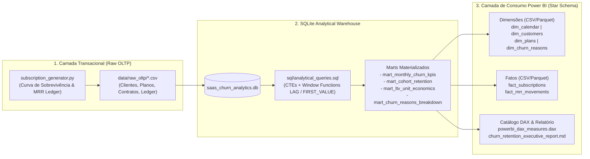
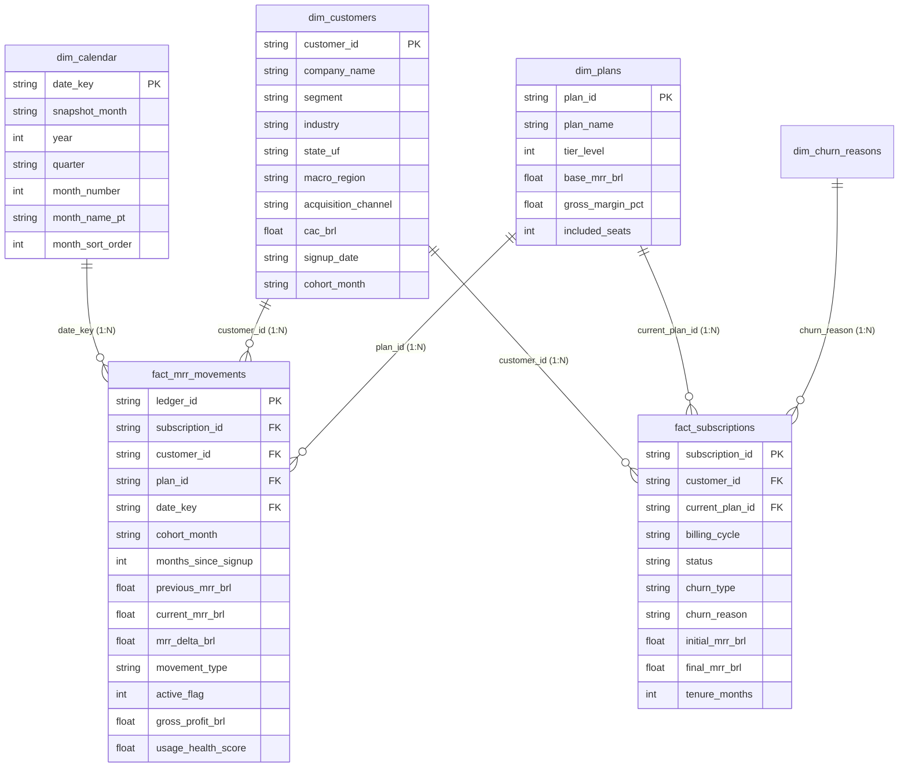

# Projeto 11: Customer Churn & Retention Analytics Dashboard (End-to-End)

Pipeline completo de **Analytics Engineering & Business Intelligence** para análise de **Cancelamento (Churn)**, **Retenção por Safra (Cohort Analysis)**, **Movimentação de Receita Recorrente (MRR Bridge)** e **Unit Economics (`LTV`, `CAC`, `LTV:CAC`, `Payback`)** em modelos de negócio de Assinatura / SaaS B2B.

---

## 1. Arquitetura do Pipeline Analítico (End-to-End)

O projeto implementa uma arquitetura em camadas que parte da simulação transacional de contratos e eventos de cobrança (OLTP), passa pela modelagem analítica em SQL avançado (CTEs e Window Functions no Data Warehouse local SQLite) e entrega um **Star Schema** otimizado (em **CSV** e **Apache Parquet**) acompanhado de um catálogo de medidas **DAX** para consumo imediato no **Power BI**.



---

## 2. Racional de Negócio das Métricas e Formulação Matemática

Em empresas de receita recorrente (SaaS, Telecom, Fintechs, Clubes de Assinatura), analisar apenas o número bruto de cancelamentos distorce a saúde financeira do negócio. Um cancelamento de um cliente `Enterprise` (`R$ 1.899/mês`) tem impacto econômico quase 10x superior ao de um cliente `Starter` (`R$ 199/mês`). Por isso, este pipeline separa rigorosamente **Métricas de Volume de Contas (Logo)** de **Métricas de Receita Recorrente (MRR / Dollar)**.

### 2.1. Identidade Contábil do MRR Bridge

A evolução da Receita Recorrente Mensal ($\text{MRR}$) entre o início e o fechamento do mês $t$ obedece à equação fundamental auditada pelo pipeline:

$$\text{Ending MRR}_t = \text{Beginning MRR}_t + \text{New MRR}_t + \text{Expansion MRR}_t - \text{Contraction MRR}_t - \text{Churned MRR}_t$$

Onde:
- **$\text{Beginning MRR}_t$**: Receita recorrente ativa herdada do fechamento do mês anterior ($\text{Ending MRR}_{t-1}$).
- **$\text{New MRR}_t$**: Receita proveniente de novos clientes adquiridos na safra $t$ (`movement_type = 'NEW'`).
- **$\text{Expansion MRR}_t$**: Aumento de receita da base existente via *upsell* de plano ou adição de licenças/assentos (`movement_type = 'EXPANSION'`).
- **$\text{Contraction MRR}_t$**: Redução parcial de receita de clientes que continuam ativos mas fizeram *downgrade* (`movement_type = 'CONTRACTION'`).
- **$\text{Churned MRR}_t$**: Receita perdida por cancelamento total da assinatura (`movement_type = 'CHURNED'`).

---

### 2.2. Taxa de Churn Mensal: Logo Churn vs. Gross MRR Churn vs. Net MRR Churn

1. **Logo Churn Rate (Taxa de Cancelamento de Clientes):**
   Mede a fração da carteira de clientes ativos no início do mês que cancelou no período:

   $$\text{Logo Churn Rate}_t = \frac{\text{Churned Customers}_t}{\text{Beginning Customers}_t}$$

2. **Gross MRR Churn Rate (Taxa de Churn Bruto de Receita):**
   Mede a perda financeira total da carteira existente (cancelamentos totais + downgrades), sem compensar com expansões:

   $$\text{Gross MRR Churn Rate}_t = \frac{\text{Churned MRR}_t + \text{Contraction MRR}_t}{\text{Beginning MRR}_t}$$

   O complementar desta métrica é a **Retenção Bruta de Receita ($\text{GRR}$)**:
   $$\text{GRR}_t = 1 - \text{Gross MRR Churn Rate}_t$$

3. **Net MRR Churn Rate (Taxa de Churn Líquido de Receita) & NRR (Net Dollar Retention):**
   Avalia se a receita gerada por expansão (*upsell/cross-sell*) na base existente foi capaz de superar as perdas por cancelamento e contração:

   $$\text{Net MRR Churn Rate}_t = \frac{\text{Churned MRR}_t + \text{Contraction MRR}_t - \text{Expansion MRR}_t}{\text{Beginning MRR}_t}$$

   $$\text{NRR}_t = 1 - \text{Net MRR Churn Rate}_t = \frac{\text{Beginning MRR}_t - \text{Churned MRR}_t - \text{Contraction MRR}_t + \text{Expansion MRR}_t}{\text{Beginning MRR}_t}$$

   > [!IMPORTANT]
   > **Net Negative Churn ($\text{Net MRR Churn} < 0\%$ ou $\text{NRR} > 100\%$):** Quando a expansão dos clientes que ficam supera o MRR perdido pelos clientes que saem, a empresa cresce sua receita mesmo se não adquirir nenhum cliente novo no mês (observado em nosso pipeline nos meses `2025-04`, `2025-10` e `2025-11`).

---

### 2.3. Análise de Coorte de Retenção (Cohort Retention Analysis)

A média mensal de Churn mistura clientes recém-adquiridos (que sofrem o chamado *Onboarding Cliff* nos primeiros 90 dias) com clientes maduros e fidelizados. A **Análise de Coorte** agrupa os clientes pela sua safra de entrada (`cohort_month`, ex: `2025-01`) e rastreia sua sobrevivência ao longo dos meses subsequentes ($k \in \{0, 1, 2, \dots, 11\}$):

$$\text{Logo Cohort Retention}_{c, k} = \frac{\text{Active Customers}_{c, k}}{\text{Initial Cohort Customers}_{c, 0}} \times 100$$

$$\text{Dollar Cohort Retention}_{c, k} = \frac{\text{Active Cohort MRR}_{c, k}}{\text{Initial Cohort MRR}_{c, 0}} \times 100$$

---

### 2.4. Lifetime Value (LTV), CAC e Payback Period

Para avaliar a viabilidade econômica de cada canal de aquisição e segmento (`SMB`, `Mid-Market`, `Enterprise`), o LTV deve sempre ser ponderado pela **Margem Bruta ($\text{Gross Margin %}$)** do serviço (descontando custos de infraestrutura cloud, suporte e licenciamento):

$$\text{LTV}_{\text{Gross Margin}} = \frac{\text{ARPA} \times \text{Gross Margin \%}}{\text{Monthly Churn Rate}}$$

Onde $\text{Expected Lifetime (Meses)} = \frac{1}{\text{Monthly Churn Rate}}$. A eficiência de capital é medida por dois indicadores críticos:

$$\text{LTV:CAC Ratio} = \frac{\text{LTV}_{\text{Gross Margin}}}{\text{CAC}} \qquad \text{e} \qquad \text{CAC Payback (Meses)} = \frac{\text{CAC}}{\text{ARPA} \times \text{Gross Margin \%}}$$

- **Benchmark de Mercado:**
  - $\text{LTV:CAC} < 3.0\text{x}$: Custo de aquisição excessivo ou retenção frágil (ex: `SMB` via `Paid Social (LinkedIn)` com `1.60x` no diagnóstico do pipeline).
  - $\text{LTV:CAC} \ge 3.0\text{x}$ e $\text{Payback} \le 12\text{ meses}$: Crescimento sustentável e eficiente em caixa.

---

## 3. Impacto Financeiro da Retenção (Resultados Reais do Pipeline)

Diferente de aquisição pontual, a retenção atua de maneira **exponencial/composta** sobre toda a base instalada. Com base nos dados processados no fechamento de `2025-12` (`841` clientes ativos, $\text{Ending MRR} = \text{R\$ } 622.507,41$, $\text{Ending ARR} = \text{R\$ } 7.470.088,92$):

| Alavanca Estratégica de Retenção | Impacto Mensal (MRR) | Impacto Anualizado (ARR) | Impacto no Valuation (`6.0x ARR`) |
| :--- | ---: | ---: | ---: |
| **1. Reduzir o Churn Mensal em `1.0 p.p.` (Customer Success & Onboarding)** | `+R$ 78.949,52 / mês` | **`+R$ 947.394,24 / ano`** | **`+R$ 5.684.365,44`** |
| **2. Recuperar `65%` do Churn Involuntário (Dunning Inteligente & Pix/Cartão)** | `+R$ 6.593,00 / mês` | **`+R$ 79.116,02 / ano`** | **`+R$ 474.696,12`** |

1. **O Poder de `1.0 p.p.` a menos de Churn:** Reduzir a taxa de cancelamento em apenas 1 ponto percentual ao mês preserva fatias cumulativas de receita que continuam sofrendo expansão ao longo de 12 meses ($\text{MRR} \times ((1,01)^{12} - 1)$), gerando quase **R\$ 947,4 mil adicionais de ARR** e adicionando **R\$ 5,68 milhões** em valor de mercado (*Enterprise Valuation* a um múltiplo conservador de `6x ARR`).
2. **Eliminação do Churn Involuntário (Fricção de Pagamento):** `12%` dos cancelamentos simulados decorrem de cartões expirados ou falha temporária de cobrança (`R$ 121.716,96` em ARR perdido). A implementação de réguas automatizadas de *Dunning*, *Account Updater* das bandeiras e *fallback* para Pix Recorrente recupera `65%` desse montante sem custo adicional de aquisição.

---

## 4. Modelagem Star Schema para Power BI

O script [`src/powerbi_exporter.py`](file:///c:/Users/Samir/Downloads/PROJETOS%20PYTHON%20v2/11-churn-analytics-pipeline/src/powerbi_exporter.py) estrutura e exporta todas as tabelas dimensionais, fatos e marts em `data/powerbi_mart/` nos formatos **CSV** e **Parquet**.

### 4.1. Diagrama de Relacionamentos do Modelo Dimensional (Star Schema)



### 4.2. Passo a Passo para Montar o Dashboard no Power BI Desktop

1. **Importação de Dados (Parquet ou CSV):**
   - No Power BI Desktop, acesse **Obter Dados -> Parquet** (recomendado pela tipagem nativa e compressão colunar) ou **Texto/CSV** apontando para a pasta `data/powerbi_mart/`.
   - Carregue as dimensões (`dim_calendar`, `dim_customers`, `dim_plans`, `dim_churn_reasons`), a tabela fato principal (`fact_mrr_movements`, `fact_subscriptions`) e os marts analíticos (`mart_cohort_retention`, `mart_ltv_unit_economics`).
2. **Configuração da Tabela Calendário:**
   - Selecione `dim_calendar`, clique em **Ferramentas de Tabela -> Marcar como tabela de data** utilizando a coluna `date_key`.
   - Ordene a coluna `month_name_pt` pela coluna numérica `month_number` (**Classificar por coluna**).
3. **Criação dos Relacionamentos (`Exibição de Modelo`):**
   - `dim_calendar[date_key]` `1 -> *` `fact_mrr_movements[date_key]` (Filtro único)
   - `dim_customers[customer_id]` `1 -> *` `fact_mrr_movements[customer_id]` (Filtro único)
   - `dim_plans[plan_id]` `1 -> *` `fact_mrr_movements[plan_id]` (Filtro único)
4. **Medidas DAX Prontas:**
   - Abra o arquivo [`data/powerbi_mart/powerbi_dax_measures.dax`](file:///c:/Users/Samir/Downloads/PROJETOS%20PYTHON%20v2/11-churn-analytics-pipeline/data/powerbi_dax_measures.dax) e adicione as 16 medidas oficiais (`Logo Churn Rate %`, `Gross MRR Churn %`, `Net MRR Churn %`, `Net Revenue Retention (NRR %)`, `Cohort Logo Retention %`, `Customer LTV (BRL)`).
5. **Construção do Visual de Matriz de Coorte (Heatmap Triangular):**
   - Insira um visual de **Matriz** no Power BI utilizando a tabela `mart_cohort_retention`:
     - **Linhas:** `cohort_month`
     - **Colunas:** `period_label` (`M00` a `M11`)
     - **Valores:** `logo_retention_pct` (ou `dollar_retention_pct`)
   - Em **Formatar seu visual -> Elementos da célula -> Cor da tela de fundo**, ative o **Gradiente** (Mínimo = Vermelho suave `#F8D7DA`, Centro `80%` = Amarelo `#FFF3CD`, Máximo `100%` = Verde `#D1E7DD`).

---

## 5. Estrutura de Diretórios do Projeto

```text
11-churn-analytics-pipeline/
├── data/
│   ├── raw_oltp/                       # CSVs transacionais brutos gerados na Etapa 1
│   ├── warehouse/
│   │   └── saas_churn_analytics.db     # Banco SQLite com tabelas raw_* e marts analíticos
│   └── powerbi_mart/                   # Star Schema exportado (CSV + Parquet + catálogo .dax)
├── reports/
│   └── churn_retention_executive_report.md # Relatório executivo gerado automaticamente
├── scripts/
│   ├── 1_generate_subscriptions.py     # Script isolado da Etapa 1 (Geração OLTP)
│   ├── 2_run_sql_analytics.py          # Script isolado da Etapa 2 (Motor SQL)
│   └── 3_export_powerbi_mart.py        # Script isolado da Etapa 3 (Exportador Power BI)
├── sql/
│   └── analytical_queries.sql          # Consultas SQL (MRR Bridge, Cohort Matrix, LTV:CAC)
├── src/
│   ├── __init__.py
│   ├── config.py                       # Configurações e parâmetros financeiros de SaaS
│   ├── subscription_generator.py       # Simulador estocástico de assinaturas e churn
│   ├── analytics_engine.py             # Executor SQL, pivot de coortes e simulação financeira
│   └── powerbi_exporter.py             # Construtor do Star Schema, DAX e relatório Markdown
├── tests/
│   └── test_churn_analytics.py         # Suíte de testes unitários e validação contábil
├── run_churn_pipeline.py               # Orquestrador End-to-End do pipeline
└── README.md                           # Documentação técnica e de negócio
```

---

## 6. Como Executar o Pipeline e os Testes

### 6.1. Executar o Pipeline End-to-End

A partir da raiz do workspace ou de dentro da pasta `11-churn-analytics-pipeline`:

```powershell
python 11-churn-analytics-pipeline/run_churn_pipeline.py --clean
```

Você também pode executar cada etapa modularmente:

```powershell
python 11-churn-analytics-pipeline/scripts/1_generate_subscriptions.py
python 11-churn-analytics-pipeline/scripts/2_run_sql_analytics.py
python 11-churn-analytics-pipeline/scripts/3_export_powerbi_mart.py
```

### 6.2. Executar a Suíte de Testes Automatizados (`pytest` / `unittest`)

```powershell
pytest 11-churn-analytics-pipeline/tests/test_churn_analytics.py -v
```
