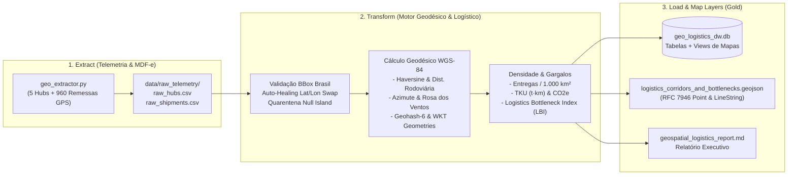
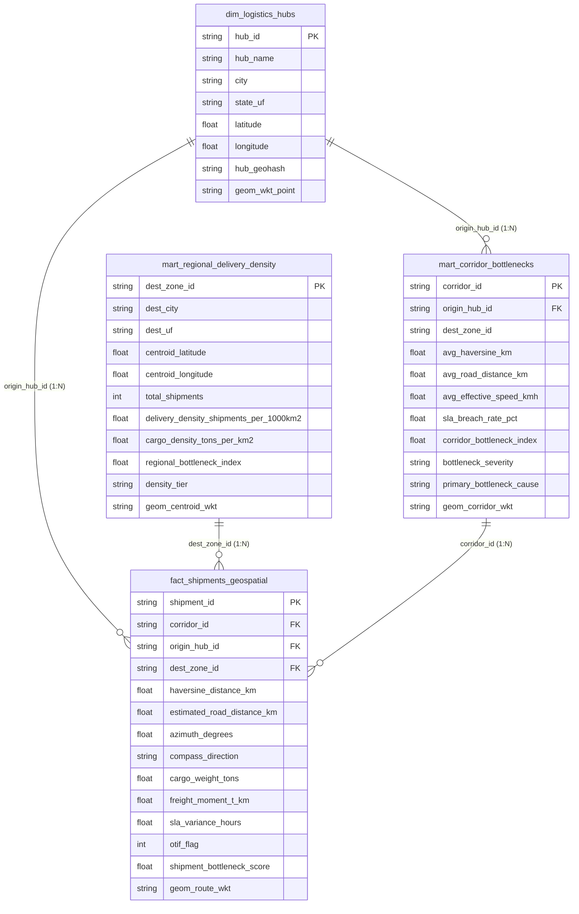

# Projeto 12: ETL de Dados Geoespaciais e Logísticos

Pipeline completo de **Engenharia de Dados Geoespaciais e Inteligência Logística** desenvolvido em Python para processar telemetria GPS de transporte de cargas (coordenadas de origem e destino, pesos, cubagem, modais e prazos de SLA), calcular métricas geodésicas e operacionais (**Distância de Haversine**, **Distância Rodoviária Estimada**, **Azimute**, **Geohash**, **Densidade Regional de Entregas** e **Índice de Gargalo Logístico - LBI**) e persistir o resultado em um **Data Warehouse Relacional (SQLite)** e em camadas **GeoJSON / Parquet** estruturadas para visualização em mapas gerenciais.

---

## 1. Arquitetura do Pipeline ETL Geoespacial



---

## 2. Engenharia Geoespacial e Formulação Matemática

### 2.1. Saneamento de Coordenadas GPS: Auto-Healing & Quarentena Espacial

Dispositivos de telemetria veicular frequentemente apresentam duas classes de falhas:
1. **Inversão de Coordenadas (`Swapped Lat/Lon`):** O integrador envia `(longitude, latitude)` no lugar de `(latitude, longitude)` (ex: `(-46.6333, -23.5505)` para São Paulo). A função [`validate_and_heal_coordinates`](file:///c:/Users/Samir/Downloads/PROJETOS%20PYTHON%20v2/12-geo-logistics-etl/src/geo_transformer.py#L36-L53) verifica se o ponto está dentro do *Bounding Box* territorial brasileiro ($\text{lat} \in [-33.75^\circ, +5.27^\circ]$, $\text{lon} \in [-73.99^\circ, -34.79^\circ]$); caso contrário, testa a permutação $(\text{lon}, \text{lat})$ e recupera automaticamente o registro marcando `coordinate_quality_status = 'AUTO_HEALED_SWAPPED_LATLON'`.
2. **Coordenadas Corrompidas (`Null Island` ou Oceânicas):** Registros sem fixação de satélite `(0.0, 0.0)` ou que caem no Oceano Atlântico (leste de `-34.79°`) são bloqueados e desviados para a tabela de auditoria `quarantine_spatial_anomalies`.

---

### 2.2. Distância Geodésica de Haversine vs. Distância Rodoviária Estimada

Dadas as coordenadas esféricas de origem $(\phi_1, \lambda_1)$ e destino $(\phi_2, \lambda_2)$ em radianos e o raio médio esférico da Terra no elipsoide WGS-84 ($R = 6371,0088\text{ km}$), a distância em linha reta sobre a curvatura terrestre (**Grande Círculo / Haversine**) é calculada por [`haversine_distance_km`](file:///c:/Users/Samir/Downloads/PROJETOS%20PYTHON%20v2/12-geo-logistics-etl/src/geo_transformer.py#L56-L70):

$$a = \sin^2\left(\frac{\Delta \phi}{2}\right) + \cos(\phi_1)\cdot\cos(\phi_2)\cdot\sin^2\left(\frac{\Delta \lambda}{2}\right)$$

$$d_{\text{Haversine}} = 2 \cdot R \cdot \arctan2\left(\sqrt{a}, \sqrt{1 - a}\right)$$

Como caminhões percorrem malhas rodoviárias sujeitas a topografia de serra e travessias fluviais, aplicamos o **Índice de Tortuosidade Rodoviária Regional ($\kappa \in [1,18;\; 1,52]$)** para obter a **Distância Rodoviária Estimada ($d_{\text{Road}}$)** e o **Momento de Transporte ($\text{TKU}$ em $\text{t}\cdot\text{km}$)**:

$$d_{\text{Road}} = d_{\text{Haversine}} \times \kappa_{\text{região}} \qquad \text{e} \qquad \text{TKU} = \text{Peso (toneladas)} \times d_{\text{Road}}$$

---

### 2.3. Azimute Inicial (Forward Bearing) e Indexação Espacial (Geohash-6 & WKT)

- **Azimute Inicial ($\theta \in [0^\circ, 360^\circ)$):** Calculado em [`forward_azimuth_degrees`](file:///c:/Users/Samir/Downloads/PROJETOS%20PYTHON%20v2/12-geo-logistics-etl/src/geo_transformer.py#L73-L87) para classificar o vetor direcional de cada corredor na Rosa dos Ventos (`N`, `NE`, `E`, `SE`, `S`, `SW`, `W`, `NW`):

  $$\theta = \left(\text{deg}\left(\arctan2\left(\sin(\Delta\lambda)\cos\phi_2,\; \cos\phi_1\sin\phi_2 - \sin\phi_1\cos\phi_2\cos(\Delta\lambda)\right)\right) + 360^\circ\right) \bmod 360^\circ$$

- **Geohash Base32 (Precisão 6):** Implementado em Python puro em [`encode_geohash`](file:///c:/Users/Samir/Downloads/PROJETOS%20PYTHON%20v2/12-geo-logistics-etl/src/geo_transformer.py#L96-L135), particiona recursivamente o espaço bidimensional em células de aproximadamente $1,2\text{ km} \times 0,6\text{ km}$ (ex: `6gyf4b` para o centro de São Paulo), permitindo agrupamento espacial ultrarrápido via `GROUP BY dest_geohash`.
- **Geometrias OGC Well-Known Text (WKT):** Cada registro persiste colunas `POINT (lon lat)` e `LINESTRING (lon1 lat1, lon2 lat2)`, compatíveis nativamente com PostGIS, QGIS, DuckDB Spatial e Power BI Icon Map.

---

### 2.4. Densidade de Entregas por Região e Índice de Gargalo Logístico (LBI)

1. **Densidade Espacial de Entregas e de Carga:**
   Na tabela `mart_regional_delivery_density`, normalizamos o volume de entregas e a tonelagem pela área territorial metropolitana ($\text{km}^2$) de cada polo consumidor:

   $$\text{Densidade de Entregas} = \frac{\text{Total de Entregas na Zona}}{\text{Área da Zona (km}^2\text{)}} \times 1.000 \quad \left[\frac{\text{entregas}}{1.000\text{ km}^2}\right]$$

   $$\text{Densidade de Carga} = \frac{\text{Toneladas Entregues na Zona}}{\text{Área da Zona (km}^2\text{)}} \quad \left[\frac{\text{t}}{\text{km}^2}\right]$$

2. **Logistics Bottleneck Index ($\text{LBI} \in [0, 100]$):**
   Pontuação composta calculada por remessa e agregada por corredor (`mart_corridor_bottlenecks`) somando três fatores de perda operacional:
   - **Severidade de Atraso de SLA (até 50 pts):** Proporcional ao excesso percentual de horas reais sobre o prazo prometido ($\max(0, \text{Actual} - \text{Promised}) / \text{Promised}$).
   - **Retenção em Pátio/Doca (até 25 pts):** Penaliza esperas de carregamento/descarregamento acima do benchmark operacional de `2,5 horas`.
   - **Degradação de Velocidade Efetiva (até 25 pts):** Mede a queda da velocidade média líquida em trânsito ($\text{km/h}$) frente à velocidade de cruzeiro nominal do modal veicular.

---

## 3. Modelagem do Banco de Dados Relacional para Mapas Gerenciais

O banco SQLite [`data/gold_warehouse/geo_logistics_dw.db`](file:///c:/Users/Samir/Downloads/PROJETOS%20PYTHON%20v2/12-geo-logistics-etl/data/gold_warehouse/geo_logistics_dw.db) é estruturado com 5 tabelas físicas e 2 Views analíticas prontas para ferramentas de GIS e BI:



### Camadas Prontas para Visualização em Mapas (`data/map_exports/`)

1. **`vw_map_flow_arcs` ([`vw_map_flow_arcs.csv`](file:///c:/Users/Samir/Downloads/PROJETOS%20PYTHON%20v2/12-geo-logistics-etl/data/map_exports/vw_map_flow_arcs.csv)):**
   - Ideal para **Mapas de Fluxo / Arcos Origem-Destino** (Power BI Icon Map, Kepler.gl Arc Layer, Deck.gl).
   - Inclui coordenadas de início/fim, WKT `LINESTRING`, volume de carga, velocidade média e código de cor hexadecimal automático (`#DC2626` Vermelho para Gargalo Crítico, `#D97706` Âmbar para Congestão Moderada e `#16A34A` Verde para Corredor Ótimo).
2. **`vw_map_heatmap_grid_cells` ([`vw_map_heatmap_grid_cells.csv`](file:///c:/Users/Samir/Downloads/PROJETOS%20PYTHON%20v2/12-geo-logistics-etl/data/map_exports/vw_map_heatmap_grid_cells.csv)):**
   - Ideal para **Mapas de Calor (Heatmaps) e Mapas de Bolhas por Quadrícula Espacial (`GRID_1°x1°`)**.
3. **Arquivo GeoJSON Unificado ([`logistics_corridors_and_bottlenecks.geojson`](file:///c:/Users/Samir/Downloads/PROJETOS%20PYTHON%20v2/12-geo-logistics-etl/data/map_exports/logistics_corridors_and_bottlenecks.geojson)):**
   - Padrão **RFC 7946 (`CRS84`)** combinando feições `Point` (Hubs e Centroides de Densidade) e `LineString` (65 Corredores Logísticos) para abertura imediata no **QGIS**, **Kepler.gl** ou **Azure Maps**.

---

## 4. Principais Resultados Analíticos do Pipeline

- **Volume Processado:** `960` remessas extraídas $\rightarrow$ `949` remessas válidas persistidas na camada Gold (`8` coordenadas invertidas recuperadas automaticamente via *Auto-Healing* e `11` anomalias bloqueadas na quarentena espacial).
- **Métricas de Transporte:** `13.811,05 toneladas` movimentadas | Momento de Transporte Total de `15.757.506,00 t·km` | Distância Haversine média de `641,03 km` vs. Distância Rodoviária média de `859,58 km` | Velocidade efetiva média de `47,03 km/h`.
- **Top 3 Polos em Densidade de Entregas (`entregas / 1.000 km²`):**
  1. **Campinas (SP):** `111,95 entregas / 1.000 km²` (`OTIF = 89,9%`, $\text{LBI} = 10,9$ - fluxo rápido via rodovias Bandeirantes/Anhanguera).
  2. **Belo Horizonte (MG):** `100,00 entregas / 1.000 km²` (`1,620 t/km²`, `OTIF = 71,6%`, $\text{LBI} = 24,9$).
  3. **São Paulo Capital (SP):** `92,04 entregas / 1.000 km²` (`140 entregas`, `OTIF = 70,7%`, $\text{LBI} = 22,4$).
- **Principais Gargalos Logísticos Identificados:**
  - Corredores de longa distância para o **Norte (`Belém/PA` e `Manaus/AM`)** e **Nordeste (`Salvador/BA`, `Fortaleza/CE`)** apresentam os maiores Índices de Gargalo Logístico ($\text{LBI}$ Regional de `41,6` em Belém e `41,1` em Manaus), impulsionados por tempo de espera em balsas rodofluviais, retenção em postos fiscais interestaduais (SEFAZ) e sobrecarga de fila de doca.

---

## 5. Estrutura de Diretórios do Projeto

```text
12-geo-logistics-etl/
├── data/
│   ├── raw_telemetry/                  # CSVs brutos de Hubs e Remessas GPS (Stage 1)
│   ├── silver_enriched/                # Camada Silver em formato colunar Apache Parquet (Stage 2)
│   ├── gold_warehouse/
│   │   └── geo_logistics_dw.db         # Banco Relacional SQLite estruturado para mapas (Stage 3)
│   └── map_exports/                    # GeoJSON RFC 7946 + CSVs das tabelas e Views de Mapas
├── reports/
│   └── geospatial_logistics_report.md  # Relatório executivo gerado automaticamente
├── scripts/
│   ├── 1_extract_geo_telemetry.py      # Execução isolada da Etapa 1 (Extract)
│   ├── 2_transform_geospatial.py       # Execução isolada da Etapa 2 (Transform)
│   └── 3_load_spatial_warehouse.py     # Execução isolada da Etapa 3 (Load & GeoJSON)
├── src/
│   ├── __init__.py
│   ├── config.py                       # Constantes geodésicas WGS-84, Hubs, Zonas e Modais
│   ├── geo_extractor.py                # Simulador/Extrator de telemetria GPS e anomalias
│   ├── geo_transformer.py              # Motor Haversine, Azimute, Geohash, WKT, Densidade e LBI
│   └── geo_loader.py                   # Loader SQLite, Views espaciais, GeoJSON e Relatório
├── tests/
│   └── test_geo_logistics_etl.py       # Suíte de testes unitários e validação geodésica
├── run_geo_etl.py                      # Orquestrador End-to-End do pipeline ETL
└── README.md                           # Documentação técnica e guia de visualização espacial
```

---

## 6. Como Executar o Pipeline e os Testes

### 6.1. Executar o Pipeline ETL Completo

```powershell
python 12-geo-logistics-etl/run_geo_etl.py --clean
```

Ou executando cada etapa individualmente:

```powershell
python 12-geo-logistics-etl/scripts/1_extract_geo_telemetry.py
python 12-geo-logistics-etl/scripts/2_transform_geospatial.py
python 12-geo-logistics-etl/scripts/3_load_spatial_warehouse.py
```

### 6.2. Executar a Suíte de Testes Automatizados (`pytest`)

```powershell
pytest 12-geo-logistics-etl/tests/test_geo_logistics_etl.py -v
```
