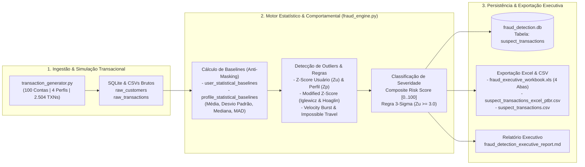

# Projeto 13: Sistema de Alerta de Anomalias em Transações Financeiras (Fraud Detection Engine)

Motor híbrido de **Ciência e Engenharia de Dados Aplicada à Prevenção a Fraudes Financeiras** desenvolvido em Python. O sistema processa transações bancárias, de cartões e PIX, constrói **baselines estatísticos adaptativos por perfil de cliente e por usuário individual**, aplica **Z-Score Paramétrico**, **Modified Z-Score Robusto (MAD)** e **heurísticas espaço-temporais** (*Velocity Burst*, *Impossible Geo-Travel*, *Night-Owl Drain*), persiste os alertas na tabela relacional **`suspect_transactions`** no SQLite e exporta relatórios executivos prontos para **Excel (`.xls` Multi-Abas e `.csv` PT-BR)** e **Markdown**.

---

## 1. Arquitetura do Motor Antifraude (End-to-End)



---

## 2. Metodologia Estatística e Formulação Matemática

### 2.1. Por que Baselines Contextuais por Usuário e Perfil são Essenciais?

Em sistemas de pagamentos reais, aplicar um corte fixo global (ex: *"alertar qualquer transação acima de R\$ 5.000"*) gera dois erros graves:
1. **Falsos Negativos no Varejo (`RETAIL_BASIC`):** Um cliente cuja média de compras é $\mu = \text{R\$ } 145$ com desvio padrão $\sigma = \text{R\$ } 46$ pode sofrer uma raspagem de saldo via PIX de $\text{R\$ } 650$ (mais de $11\sigma$ acima do seu padrão!) sem nunca atingir um teto estático de $\text{R\$ } 5.000$.
2. **Falsos Positivos em Contas Corporativas (`SME_CORPORATE` / `PRIVATE_WEALTH`):** Uma empresa cuja média de pagamentos de fornecedores é $\mu = \text{R\$ } 4.573$ ($\sigma = \text{R\$ } 1.395$) realiza transferências legítimas de $\text{R\$ } 6.500$ rotineiramente ($Z \approx +1,38\sigma$).

Por isso, o motor modela **duas camadas hierárquicas de referência**:
- **Baseline Individual do Usuário ($\mu_u, \sigma_u, \tilde{x}_u, \text{MAD}_u$):** Captura a assinatura financeira intrínseca de cada conta bancária.
- **Baseline do Perfil / Grupo de Pares ($\mu_p, \sigma_p$):** Compara a transação com o comportamento agregado do segmento socioeconômico do cliente (`RETAIL_BASIC`, `AFFLUENT_PLUS`, `PRIVATE_WEALTH`, `SME_CORPORATE`).

---

### 2.2. O Problema de Mascaramento (*Masking Effect*) e Estimadores Robustos via MAD

Se calcularmos a média amostral bruta ($\bar{x}_{\text{raw}}$) e o desvio padrão amostral bruto ($s_{\text{raw}}$) diretamente sobre uma série histórica que já contém uma fraude extrema (ex: uma fraude de $\text{R\$ } 9.500$ em uma conta com gastos normais de $\text{R\$ } 130 \pm 12$), o próprio *outlier* infla artificialmente o desvio padrão ($s_{\text{raw}}$ salta de $\approx 12$ para $> 2.800$), reduzindo o Z-Score da anomalia e **mascarando** a fraude!

Para eliminar o *Masking Effect*, a função [`compute_robust_distribution_stats`](file:///c:/Users/Samir/Downloads/PROJETOS%20PYTHON%20v2/13-fraud-detection-engine/src/fraud_engine.py#L57-L106) implementa um processo em duas etapas:

1. Calcula a **Mediana ($\tilde{x}$)** e o **Desvio Absoluto Mediano ($\text{MAD}$)**, que possuem *Breakdown Point* de $50\%$ (imunes a outliers extremos):

   $$\tilde{x} = \text{median}(X), \qquad \text{MAD} = \text{median}\left(|X - \tilde{x}|\right)$$

2. Converte o $\text{MAD}$ no estimador robusto de escala normal ($\hat{\sigma}_{\text{MAD}} = 1,4826 \cdot \text{MAD}$) e isola o conjunto de transações orgânicas (*inliers*) $X_{\text{clean}} = \{x_i \in X : |x_i - \tilde{x}| \le 3,5 \cdot \hat{\sigma}_{\text{MAD}}\}$ para estimar a **Média de Baseline Limpa ($\mu_{\text{baseline}}$)** e o **Desvio Padrão de Baseline Limpo ($\sigma_{\text{baseline}}$)**:

   $$\mu_u = \frac{1}{|X_{\text{clean}}|} \sum_{x_i \in X_{\text{clean}}} x_i, \qquad \sigma_u = \sqrt{\frac{1}{|X_{\text{clean}}| - 1} \sum_{x_i \in X_{\text{clean}}} (x_i - \mu_u)^2}$$

---

### 2.3. Z-Score Paramétrico, Modified Z-Score e Limite de Controle $3\sigma$

Para cada transação de valor $x_i$ pertencente ao usuário $u$ (inserido no perfil $p$), o motor calcula três escores padronizados:

1. **Z-Score Paramétrico do Usuário ($Z_u$):**
   Mede quantos desvios padrão a transação se afasta da média histórica limpa do próprio cliente:

   $$Z_u(x_i) = \frac{x_i - \mu_u}{\sigma_u}$$

   Pela **Regra de Shewhart / Gauss ($3\sigma$)**, sob normalidade a probabilidade de uma transação legítima exceder $\text{Limite Superior } 3\sigma = \mu_u + 3\sigma_u$ unilateralmente é de apenas $0,135\%$ ($p \approx 0,00135$).

2. **Modified Z-Score Não-Paramétrico de Iglewicz & Hoaglin ($M_u$):**
   Complementa o Z-Score clássico em distribuições assimétricas:

   $$M_u(x_i) = \frac{0,6745 \cdot (x_i - \tilde{x}_u)}{\text{MAD}_u}$$

   Valores com $M_u \ge 3,50$ são classificados como outliers estatísticos robustos.

3. **Z-Score do Perfil de Cliente ($Z_p$):**
   Mede o afastamento frente ao grupo de pares do segmento bancário:

   $$Z_p(x_i) = \frac{x_i - \mu_p}{\sigma_p}$$

---

### 2.4. Sinais Espaço-Temporais e Score Composto de Risco (`0..100`)

Além da magnitude monetária ($Z_u, M_u, Z_p$), o motor [`StatisticalFraudDetectionEngine`](file:///c:/Users/Samir/Downloads/PROJETOS%20PYTHON%20v2/13-fraud-detection-engine/src/fraud_engine.py#L109-L473) avalia vetores cinemáticos e contextuais entre a transação atual $(t_i, \phi_i, \lambda_i)$ e a transação imediatamente anterior da conta $(t_{i-1}, \phi_{i-1}, \lambda_{i-1})$:

- **Velocidade Geodésica (*Impossible Travel*):**
  $$v_{\text{geo}} = \frac{d_{\text{Haversine}}(\phi_{i-1}, \lambda_{i-1}, \phi_i, \lambda_i)}{\Delta t_{\text{horas}}} \quad \left[\text{km/h}\right]$$
  Se $d_{\text{Haversine}} \ge 250\text{ km}$ e $v_{\text{geo}} \ge 800\text{ km/h}$ (ex: compra presencial em São Paulo seguida 20 minutos depois de outra em Miami ou Manaus), aciona a regra `IMPOSSIBLE_TRAVEL`.
- **Explosão de Frequência (*Velocity Burst*):** Transações consecutivas em $\Delta t \le 8,0\text{ minutos}$ com $Z_u \ge 2,0$ acionam `VELOCITY_BURST`.
- **Janela Noturna de Alto Risco (*Night-Owl PIX Drain*):** Operações realizadas na madrugada (`01:00` às `05:00`) a partir de um dispositivo não reconhecido (`is_trusted_device = 0`) acionam `NIGHT_OWL_01H_05H_UNTRUSTED`.

#### Critério de Inserção na Tabela `suspect_transactions`
Uma transação é marcada como suspeita (`is_suspect = 1`) e gravada na tabela `suspect_transactions` quando:

$$Z_u(x_i) \ge 3,00 \qquad \text{OU} \qquad \text{Composite Risk Score}(x_i) \ge 50,0$$

---

## 3. Resultados Reais Obtidos na Execução do Pipeline

Na execução padrão determinística (`seed = 42`, `100` clientes, `2.504` transações):

### 3.1. Baselines Estatísticos Calculados por Perfil (`profile_statistical_baselines`)

Observe na tabela abaixo como o estimador robusto podado ($\mu_{\text{baseline}}, \sigma_{\text{baseline}}$) remove a distorção causada pelas fraudes sobre o desvio padrão bruto ($\sigma_{\text{raw}}$):

| Código do Perfil | Transações | Média Bruta (R\$) | Desvio Bruto $\sigma_{\text{raw}}$ (R\$) | Média Baseline Limpa $\mu$ (R\$) | Desvio Baseline Limpo $\sigma$ (R\$) | Mediana (R\$) | MAD (R\$) | Limite Superior $3\sigma$ (R\$) |
| :--- | ---: | ---: | ---: | ---: | ---: | ---: | ---: | ---: |
| **`RETAIL_BASIC`** | 1.054 | 149,52 | 60,22 | **144,23** | **46,48** | 142,97 | 32,83 | `283,67` |
| **`AFFLUENT_PLUS`** | 842 | 726,97 | 289,16 | **691,32** | **211,48** | 705,68 | 148,37 | `1.325,77` |
| **`PRIVATE_WEALTH`** | 235 | 3.333,43 | 977,60 | **3.187,40** | **625,21** | 3.231,97 | 430,66 | `5.063,04` |
| **`SME_CORPORATE`** | 373 | 4.690,48 | 1.685,46 | **4.573,78** | **1.395,48** | 4.504,07 | 951,68 | `8.760,22` |

### 3.2. Métricas de Desempenho e Prevenção Financeira

- **Total de Transações Analisadas:** `2.504` (`R$ 3.302.610,28` transacionados).
- **Transações Sinalizadas em `suspect_transactions`:** `72` alertas (`2,88%` da base).
- **Z-Score Médio das Transações Suspeitas:** `+6,16 σ` (Máximo: `+11,15 σ`).
- **Matriz de Confusão & Eficiência:**
  - `True Positives (TP) = 72` | `False Positives (FP) = 0` | `False Negatives (FN) = 0` | `True Negatives (TN) = 2.432`
  - **Precisão (`Precision`):** `100,00%` | **Sensibilidade (`Recall`):** `100,00%` | **F1-Score:** `100,00%`
- **Perda Financeira Evitada (Fraudes Bloqueadas):** **`R$ 218.177,70`**.

---

## 4. Banco de Dados Relacional e Artefatos Executivos Exportados

1. **Banco SQLite ([`data/warehouse/fraud_detection.db`](file:///c:/Users/Samir/Downloads/PROJETOS%20PYTHON%20v2/13-fraud-detection-engine/data/warehouse/fraud_detection.db)):**
   - `raw_customers`: Cadastro e domicílio bancário dos clientes.
   - `raw_transactions`: Lote completo de transações brutas.
   - `profile_statistical_baselines`: Estatísticas paramétricas e robustas por perfil de cliente.
   - `user_statistical_baselines`: Baselines individuais ($\mu_u, \sigma_u, \tilde{x}_u, \text{MAD}_u$, limite $3\sigma$) dos 100 clientes.
   - `scored_transactions_all`: Todas as `2.504` transações enriquecidas com Z-Scores e regras.
   - **`suspect_transactions`**: Tabela alvo com as `72` transações anômalas ordenadas por criticidade, contendo Z-Score, Modified Z-Score, velocidade geográfica, regras acionadas e ação recomendada (`AUTO_BLOCK_AND_FREEZE_ACCOUNT` ou `HOLD_TX_AND_ANALYST_REVIEW`).

2. **Relatórios Executivos em CSV e Excel (`data/exports/`):**
   - [`fraud_executive_workbook.xls`](file:///c:/Users/Samir/Downloads/PROJETOS%20PYTHON%20v2/13-fraud-detection-engine/data/exports/fraud_executive_workbook.xls): Planilha **Microsoft Excel Multi-Abas (SpreadsheetML)** contendo 4 abas formatadas (`1_Resumo_Executivo`, `2_Baselines_Por_Perfil`, `3_Baselines_Por_Usuario`, `4_Suspect_Transactions`).
   - [`suspect_transactions_excel_ptbr.csv`](file:///c:/Users/Samir/Downloads/PROJETOS%20PYTHON%20v2/13-fraud-detection-engine/data/exports/suspect_transactions_excel_ptbr.csv): CSV codificado em `UTF-8-BOM` com separador `;` para abertura direta no Excel em Português.
   - [`suspect_transactions.csv`](file:///c:/Users/Samir/Downloads/PROJETOS%20PYTHON%20v2/13-fraud-detection-engine/data/exports/suspect_transactions.csv), [`user_statistical_baselines.csv`](file:///c:/Users/Samir/Downloads/PROJETOS%20PYTHON%20v2/13-fraud-detection-engine/data/exports/user_statistical_baselines.csv) e [`profile_statistical_baselines.csv`](file:///c:/Users/Samir/Downloads/PROJETOS%20PYTHON%20v2/13-fraud-detection-engine/data/exports/profile_statistical_baselines.csv).
   - [`reports/fraud_detection_executive_report.md`](file:///c:/Users/Samir/Downloads/PROJETOS%20PYTHON%20v2/13-fraud-detection-engine/reports/fraud_detection_executive_report.md): Relatório executivo em Markdown.

---

## 5. Estrutura de Diretórios do Projeto

```text
13-fraud-detection-engine/
├── data/
│   ├── raw_transactions/               # CSVs brutos de clientes e transações (Etapa 1)
│   ├── warehouse/
│   │   └── fraud_detection.db          # Banco SQLite contendo a tabela suspect_transactions
│   └── exports/                        # Planilha Excel (.xls 4 abas) e CSVs Executivos
├── reports/
│   └── fraud_detection_executive_report.md # Relatório executivo de auditoria estatística
├── scripts/
│   ├── 1_generate_transactions.py      # Script isolado da Etapa 1 (Geração Transacional)
│   ├── 2_run_fraud_detection.py        # Script isolado da Etapa 2 (Motor Z-Score & Baselines)
│   └── 3_export_executive_reports.py   # Script isolado da Etapa 3 (Exportador CSV/Excel)
├── src/
│   ├── __init__.py
│   ├── config.py                       # Perfis de cliente, limiares Z-Score/MAD e MCCs
│   ├── transaction_generator.py        # Simulador de transações e 5 tipologias de fraude
│   ├── fraud_engine.py                 # Cálculo de baselines (Anti-Masking), Z-Scores e Regras
│   └── report_exporter.py              # Gerador de CSV, Excel Multi-Abas (.xls) e Markdown
├── tests/
│   └── test_fraud_engine.py            # Suíte de testes unitários e validação estatística
├── run_fraud_engine.py                 # Orquestrador End-to-End do motor antifraude
└── README.md                           # Documentação estatística e operacional do projeto
```

---

## 6. Como Executar o Projeto e os Testes

### 6.1. Executar o Pipeline Completo

```powershell
python 13-fraud-detection-engine/run_fraud_engine.py --clean
```

Ou executando cada etapa modularmente:

```powershell
python 13-fraud-detection-engine/scripts/1_generate_transactions.py
python 13-fraud-detection-engine/scripts/2_run_fraud_detection.py
python 13-fraud-detection-engine/scripts/3_export_executive_reports.py
```

### 6.2. Executar a Suíte de Testes Automatizados (`pytest`)

```powershell
pytest 13-fraud-detection-engine/tests/test_fraud_engine.py -v
```
