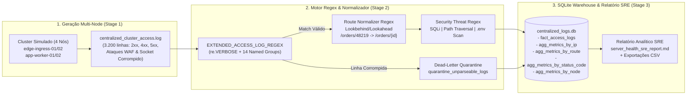
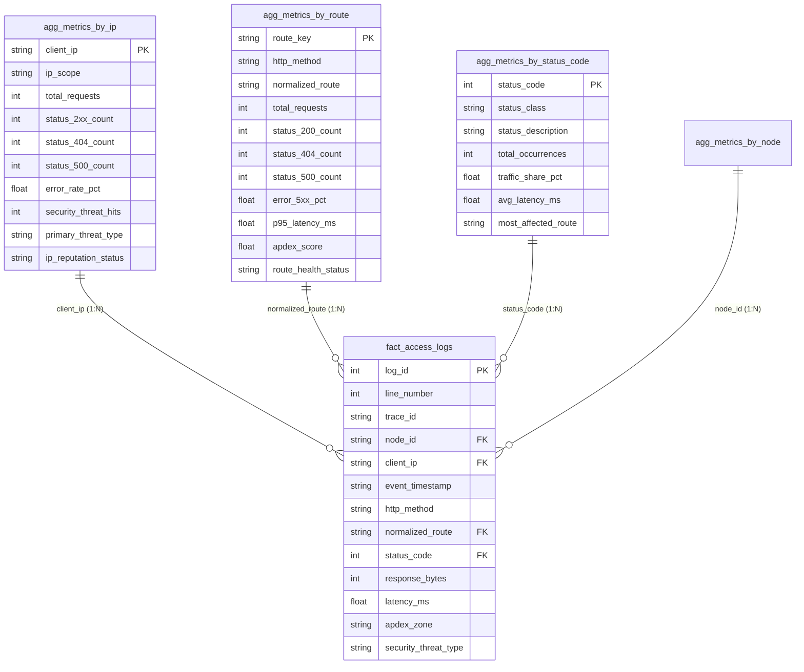

# Projeto 14: Log Aggregator & Centralized Log Parser

Pipeline de **Engenharia de Dados e Observabilidade SRE (*Site Reliability Engineering*)** desenvolvido em Python para geração, ingestão, extração via **Expressões Regulares (Regex) avançadas**, normalização de cardinalidade de rotas, detecção de ameaças WAF/SIEM, persistência relacional em **SQLite** (com agregações por **IP**, por **rota** e por **código de status HTTP**) e geração de relatório analítico de saúde do cluster de servidores.

---

## 1. Arquitetura do Pipeline de Agregação e Parseamento de Logs



---

## 2. Engenharia de Expressões Regulares (Regex) Aplicada

O núcleo de extração em [`src/regex_log_parser.py`](file:///c:/Users/Samir/Downloads/PROJETOS%20PYTHON%20v2/14-log-aggregator-parser/src/regex_log_parser.py) utiliza expressões regulares pré-compiladas (`re.compile`) combinando **Named Capture Groups (`(?P<name>...)`)**, **Non-Capturing Groups (`(?:...)`)** e asserções **Positive Lookbehind (`(?<=...)`) / Positive Lookahead (`(?=...)`)**.

### 2.1. Anatomia da Linha de Log Estendida (Nginx / Envoy Ingress)

Cada evento emitido pelos nós do cluster segue o formato estendido de observabilidade com tempos de resposta (`rt`, `uct`) e `trace_id` distribuído:

```text
[edge-ingress-01] 177.84.120.15 - usr_204 [02/Nov/2026:08:15:30 -0300] "POST /api/v1/orders/48219/checkout HTTP/1.1" 500 512 "https://app.enterprise-portal.com.br/checkout" "Mozilla/5.0 Chrome/128.0" rt=842.50 uct=810.20 trace_id=TRC-000123-9876
```

### 2.2. Expressão Regular Principal (`EXTENDED_ACCESS_LOG_REGEX`)

Compilada com a flag `re.VERBOSE` para legibilidade e manutenção de nível de produção:

```python
EXTENDED_ACCESS_LOG_REGEX = re.compile(
    r"""
    ^\[(?P<node_id>[a-zA-Z0-9._-]+)\]\s+                                  # 1. Nó do cluster
    (?P<client_ip>(?:(?:25[0-5]|2[0-4]\d|[01]?\d\d?)\.){3}                # 2. IPv4 estrito (octetos 0..255)
                  (?:25[0-5]|2[0-4]\d|[01]?\d\d?))\s+
    (?P<ident>\S+)\s+                                                     # 3. RFC 1413 ident
    (?P<auth_user>\S+)\s+                                                 # 4. Usuário autenticado
    \[(?P<raw_timestamp>\d{2}/[A-Za-z]{3}/\d{4}:\d{2}:\d{2}:\d{2}\s+[+-]\d{4})\]\s+  # 5. Timestamp c/ Timezone
    "(?P<http_method>GET|POST|PUT|DELETE|PATCH|HEAD|OPTIONS)\s+           # 6. Verbo HTTP
     (?P<raw_uri>\S+)\s+                                                  # 7. URI bruta (Path + Query)
     (?P<http_protocol>HTTP/\d\.\d)"\s+                                   # 8. Protocolo HTTP
    (?P<status_code>[1-5]\d{2})\s+                                        # 9. Status Code (100..599)
    (?P<response_bytes>\d+)\s+                                            # 10. Bytes enviados
    "(?P<referer>[^"]*)"\s+                                               # 11. Referer
    "(?P<user_agent>[^"]*)"\s+                                            # 12. User-Agent
    rt=(?P<latency_ms>\d+(?:\.\d+)?)\s+                                   # 13. Latência total (ms)
    uct=(?P<upstream_ms>\d+(?:\.\d+)?)\s+                                 # 14. Latência upstream (ms)
    trace_id=(?P<trace_id>[A-Za-z0-9_-]+)\s*$                             # 15. Trace ID distribuído
    """,
    re.VERBOSE,
)
```

| Construção Regex | Finalidade Técnica |
| :--- | :--- |
| `(?:25[0-5]\|2[0-4]\d\|[01]?\d\d?)` | Valida matematicamente cada octeto IPv4 no intervalo `[0, 255]`, rejeitando IPs inválidos como `999.84.120.15` logo no estágio de parseamento. |
| `(?P<status_code>[1-5]\d{2})` | Garante que apenas códigos de status HTTP válidos (`100` a `599`) sejam aceitos. |
| `(?P<latency_ms>\d+(?:\.\d+)?)` | Extrai números inteiros ou de ponto flutuante sem criar grupos numerados extras para a parte decimal. |

---

### 2.3. Normalização de Rotas REST com Lookaround Regex (Anti-Cardinalidade)

Em APIs RESTful, URLs contêm parâmetros dinâmicos no caminho (`/api/v1/orders/48219/checkout` ou `/api/v1/users/550e8400-e29b-41d4-a716-446655440000/profile`). Se agregarmos diretamente pela URL bruta, cada pedido gera uma linha diferente no banco de dados (*Cardinality Explosion*).

A função [`normalize_route_path`](file:///c:/Users/Samir/Downloads/PROJETOS%20PYTHON%20v2/14-log-aggregator-parser/src/regex_log_parser.py#L69-L82) aplica três Regex sequenciais baseadas em *Positive Lookbehind* `(?<=/)` e *Positive Lookahead* `(?=/|$)`:

1. **`UUID_SEGMENT_REGEX`:** `(?<=/)[0-9a-fA-F]{8}-[0-9a-fA-F]{4}-[0-9a-fA-F]{4}-[0-9a-fA-F]{4}-[0-9a-fA-F]{12}(?=/|$)` $\rightarrow$ substitui UUIDs por `{uuid}`.
2. **`NUMERIC_ID_PDF_REGEX`:** `(?<=/)\d+(?=\.pdf$)` $\rightarrow$ converte `/orders/912345/invoice.pdf` em `/orders/{id}/invoice.pdf`.
3. **`NUMERIC_ID_SEGMENT_REGEX`:** `(?<=/)\d+(?=/|$)` $\rightarrow$ converte `/orders/48219/checkout` em `/orders/{id}/checkout` preservando prefixos versionados como `/v1/` (pois `v1` começa com letra).

---

### 2.4. Detecção de Vetores de Ataque (WAF / SIEM Regex)

A função [`classify_security_threat`](file:///c:/Users/Samir/Downloads/PROJETOS%20PYTHON%20v2/14-log-aggregator-parser/src/regex_log_parser.py#L85-L96) inspeciona cada requisição contra 4 assinaturas Regex:
- **`SQL_INJECTION_REGEX`**: `(?:union\s+select|or\s+(?:%27|')\d+(?:%27|')=(?:%27|')\d+|--|;\s*drop\s+table|%27\s*or\s*)`
- **`PATH_TRAVERSAL_REGEX`**: `(?:(?:\.\./|\.\.\\|%2e%2e%2f)+|/etc/passwd|/windows/win\.ini)`
- **`SENSITIVE_PROBE_REGEX`**: `^/(?:\.env|\.git(?:/.*)?|wp-admin(?:/.*)?|phpmyadmin(?:/.*)?|actuator(?:/.*)?)$`
- **`SCANNER_UA_REGEX`**: `(?:sqlmap|nikto|nmap|credentialstuffingbot|curl/[\d.]+-scanner|masscan)`

---

## 3. Métricas SRE de Saúde do Servidor e Modelagem SQLite

O módulo [`src/log_warehouse.py`](file:///c:/Users/Samir/Downloads/PROJETOS%20PYTHON%20v2/14-log-aggregator-parser/src/log_warehouse.py) persiste os dados no banco [`data/warehouse/centralized_logs.db`](file:///c:/Users/Samir/Downloads/PROJETOS%20PYTHON%20v2/14-log-aggregator-parser/data/warehouse/centralized_logs.db) e calcula os indicadores de confiabilidade:

1. **Índice Apdex (*Application Performance Index*, limiar $T = 120\text{ ms}$):**
   $$\text{Apdex}_T = \frac{N_{\text{Satisfied}} + 0,5 \times N_{\text{Tolerating}}}{N_{\text{Total}}}$$
   Onde requisições com $\text{latência} \le 120\text{ ms}$ (e sem erro `5xx`) são *Satisfied*, entre $120\text{ ms}$ e $480\text{ ms}$ ($4T$) são *Tolerating*, e $> 480\text{ ms}$ ou com status `5xx` são *Frustrated*.

2. **Disponibilidade SLO (*Service Level Objective*):**
   $$\text{Availability \%} = \left(1 - \frac{\text{Requisições HTTP 5xx}}{\text{Total de Requisições Válidas}}\right) \times 100$$

### Esquema Relacional do Banco SQLite (`centralized_logs.db`)



---

## 4. Principais Resultados Analíticos do Relatório SRE

Na execução padrão (`3.200` linhas brutas $\rightarrow$ `3.190` eventos válidos + `10` linhas corrompidas isoladas na tabela `quarantine_unparseable_logs`):

- **Distribuição por Classe HTTP:**
  - **Sucesso `2xx`:** `2.221` requisições (`1.573` com `HTTP 200`, `327` com `HTTP 201`, `321` com `HTTP 204`).
  - **Erros de Cliente `4xx`:** `644` requisições (`504` com `HTTP 404 Not Found`, `57` com `HTTP 403 Forbidden`, `33` com `HTTP 401 Unauthorized`, `27` com `HTTP 429 Rate Limit`).
  - **Erros Críticos de Servidor `5xx`:** `325` requisições (`201` com `HTTP 500`, `48` com `HTTP 503`, `43` com `HTTP 502`, `33` com `HTTP 504 Gateway Timeout`).
- **Diagnóstico de Rotas Críticas (`agg_metrics_by_route`):**
  - `POST /api/v1/ledger/reconcile` (`100%` de taxa `5xx`, $\text{Apdex} = 0,000$), `POST /api/v1/orders/{id}/checkout` (`16,6%` `5xx`) e `POST /api/v1/payments/authorize` (`15,9%` `5xx`) concentraram a degradação de banco de dados durante a janela de incidente.
- **Segurança WAF (`agg_metrics_by_ip`):**
  - Os 4 IPs atacantes (`185.220.101.44`, `203.0.113.195`, `198.51.100.77` e `45.155.205.109`) foram automaticamente sinalizados com `MALICIOUS_BLOCK_WAF` (`100%` de taxa de erro e `282` tentativas de ataque combinadas entre *SQL Injection*, *Path Traversal* e *Sensitive File Probing*).

---

## 5. Estrutura de Diretórios do Projeto

```text
14-log-aggregator-parser/
├── data/
│   ├── raw_logs/
│   │   └── centralized_cluster_access.log # Arquivo de log bruto gerado (3.200 linhas)
│   ├── warehouse/
│   │   └── centralized_logs.db            # Banco SQLite com fatos, DLQ e 4 tabelas agregadas
│   └── parsed_exports/                    # CSVs exportados (por IP, Rota, Status, Nó e DLQ)
├── reports/
│   └── server_health_sre_report.md        # Relatório analítico SRE de saúde do servidor
├── scripts/
│   ├── 1_generate_server_logs.py          # Execução isolada da Etapa 1 (Gerador de Logs)
│   ├── 2_parse_and_load_logs.py           # Execução isolada da Etapa 2 (Parser Regex & SQLite)
│   └── 3_generate_sre_report.py           # Execução isolada da Etapa 3 (Relatório SRE & CSVs)
├── src/
│   ├── __init__.py
│   ├── config.py                          # Limiares SRE (Apdex, SLO), nós e catálogo HTTP
│   ├── log_generator.py                   # Simulador de tráfego HTTP, erros 4xx/5xx e ataques
│   ├── regex_log_parser.py                # Motor Regex compilado, normalizador de rotas e WAF
│   └── log_warehouse.py                   # Persistência SQLite, agregações e relatório Markdown
├── tests/
│   └── test_log_parser.py                 # Suíte de testes automatizados (Regex, Rotas, SQL)
├── run_log_pipeline.py                    # Orquestrador End-to-End do pipeline
└── README.md                              # Documentação técnica de Regex e arquitetura SRE
```

---

## 6. Como Executar o Pipeline e os Testes

### 6.1. Executar o Pipeline Completo

```powershell
python 14-log-aggregator-parser/run_log_pipeline.py --clean
```

Ou executando cada etapa individualmente:

```powershell
python 14-log-aggregator-parser/scripts/1_generate_server_logs.py
python 14-log-aggregator-parser/scripts/2_parse_and_load_logs.py
python 14-log-aggregator-parser/scripts/3_generate_sre_report.py
```

### 6.2. Executar a Suíte de Testes Automatizados (`pytest`)

```powershell
pytest 14-log-aggregator-parser/tests/test_log_parser.py -v
```
