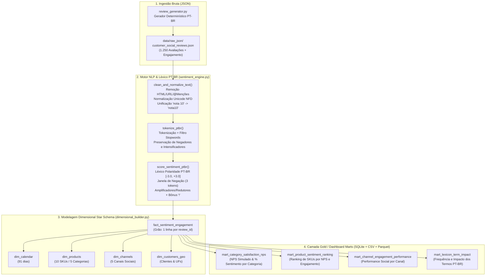
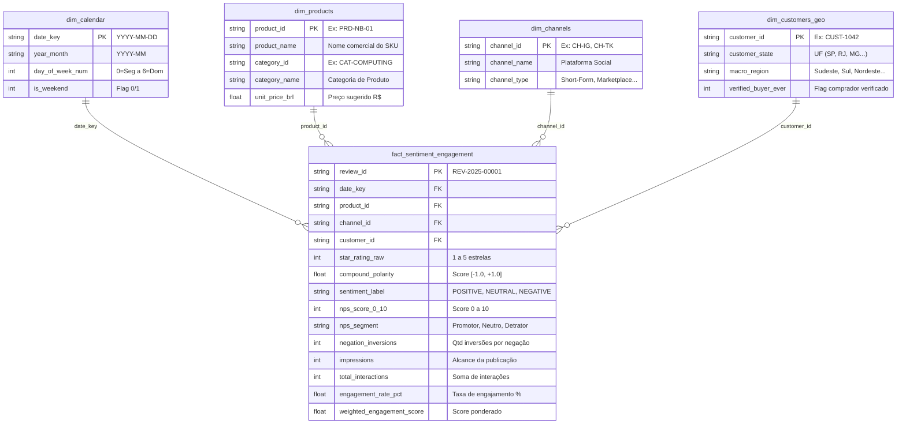

# 💬 Social Media Sentiment & Engagement Analytics Pipeline (PT-BR)

> **Projeto 15 — Engenharia de Analytics & NLP (Processamento de Linguagem Natural Baseado em Léxico):** Pipeline end-to-end para ingestão de avaliações textuais em JSON (`reviews` e menções em redes sociais), higienização linguística em português (`pt-BR`), análise de sentimento com dicionário de polaridade contextual (inversão por negação e amplificação por intensificadores), consolidação de **NPS Simulado** e métricas de engajamento social em **Star Schema Dimensional** (SQLite + CSV + Apache Parquet).

---

## 🎯 1. Visão Geral e Problema de Negócio

Equipes de Produto, CX (Customer Experience) e Social Listening recebem diariamente milhares de avaliações não estruturadas oriundas de múltiplos canais (**Instagram Reels**, **TikTok Shop**, **YouTube Tech Reviews**, **X/Twitter** e **E-Commerce Verified Reviews**). Avaliar apenas a nota numérica (*star rating*) esconde nuances críticas presentes no texto livre, como:
- Elogios ou críticas específicas a componentes (`bateria`, `entrega`, `atendimento`, `trava`, `defeito`);
- Sentenças com **negação contextual** (`"não é bom"`, `"nunca funciona"`, `"jamais recomendo"`), onde contadores ingênuos de palavras falham ao classificar `"bom"` ou `"recomendo"` como positivos;
- **Amplificação emocional** (`"muito excelente"`, `"extremamente decepcionante"`);
- Correlação entre a **polaridade do sentimento** e a **viralização/engajamento social** (curtidas, comentários, compartilhamentos e salvamentos).

Este projeto implementa um motor determinístico e auditável de **NLP Baseado em Regras e Léxico PT-BR**, acoplado a um **Data Warehouse Dimensional (Star Schema)** pronto para conexão direta em ferramentas de BI (Power BI, Tableau, Looker Studio).

---

## 🏗️ 2. Arquitetura End-to-End do Pipeline



---

## 🧠 3. Metodologia NLP: Limpeza, Léxico PT-BR e Regras Contextuais

### 3.1. Pipeline de Higienização Textual (`clean_and_normalize_text`)
Cada avaliação bruta do arquivo JSON passa por 7 etapas de normalização determinística em [`src/sentiment_engine.py`](file:///c:/Users/Samir/Downloads/PROJETOS%20PYTHON%20v2/15-sentiment-analytics-pipeline/src/sentiment_engine.py):
1. **Remoção de Marcações HTML:** Elimina tags como `<b>`, `<i>`, `<br/>` via expressão regular;
2. **Remoção de URLs e Menções:** Filtra links (`https://...`) e handles de redes sociais (`@loja_oficial`), preservando o conteúdo das hashtags (`#recomendo` $\rightarrow$ `recomendo`);
3. **Contagem de Ênfase Pontual:** Contabiliza pontos de exclamação (`!`) antes da limpeza para calibrar a intensidade emocional;
4. **Decomposição Unicode (`NFD`):** Remove acentuação gráfica (`ótimo` $\rightarrow$ `otimo`, `péssimo` $\rightarrow$ `pessimo`, `não` $\rightarrow$ `nao`) para garantir matching exato mesmo em textos digitados sem acento nas redes sociais;
5. **Unificação de Expressões Compostas:** Converte expressões idiomáticas como `"nota 10"`, `"nota dez"` e `"10/10"` no token único `nota10`;
6. **Tokenização Alfanumérica e Remoção Seletiva de Stopwords:** Remove preposições e artigos neutros (`de`, `para`, `com`, `que`), mas **preserva obrigatoriamente** todas as partículas de negação (`nao`, `nunca`, `jamais`, `nem`, `sem`) e advérbios de intensidade (`muito`, `super`, `extremamente`, `pouco`).

---

### 3.2. Cálculo Matemático de Polaridade Composta (`score_sentiment_ptbr`)

Seja $T = (t_1, t_2, \dots, t_n)$ a sequência de tokens relevantes da avaliação e $L(t_i) \in [-3.0, +3.0]$ o peso base do token no dicionário [`PTBR_POLARITY_LEXICON`](file:///c:/Users/Samir/Downloads/PROJETOS%20PYTHON%20v2/15-sentiment-analytics-pipeline/src/config.py#L48-L115):

1. **Modulador de Intensidade ($M_i$):** Verifica se os tokens imediatamente anteriores ($t_{i-1}$ ou $t_{i-2}$) pertencem ao dicionário [`INTENSIFIER_WEIGHTS`](file:///c:/Users/Samir/Downloads/PROJETOS%20PYTHON%20v2/15-sentiment-analytics-pipeline/src/config.py#L129-L150) (ex.: `extremamente` $= 1.50$, `muito` $= 1.35$, `pouco` $= 0.60$).
2. **Inversão por Janela de Negação ($N_i$):** Verifica se há um token negador (`nao`, `nunca`, `jamais`, `nem`, `sem`, `tampouco`) dentro de uma janela anterior de até $k = 3$ posições ($\{t_{\max(1, i-3)}, \dots, t_{i-1}\}$). Quando ativo, o sinal da polaridade é invertido com fator de atenuação Assimétrica ($\alpha = -0.85$):
   $$w_i = L(t_i) \times M_i \times N_i, \quad \text{onde } N_i = \begin{cases} -0.85 & \text{se houver negação na janela } [i-3, i-1] \\ +1.00 & \text{caso contrário} \end{cases}$$
   *Exemplo prático:* Na frase `"O fone não é muito bom"`, temos $L(\text{bom}) = +1.8$, $M_i(\text{muito}) = 1.35$ e $N_i(\text{nao}) = -0.85$, resultando em $w_i = +1.8 \times 1.35 \times (-0.85) = -2.0655$ (**Negativo**).

3. **Normalização Composta (Fórmula tipo VADER):** A soma bruta $S = \sum w_i$ (ajustada pelo bônus de exclamação) é projetada no intervalo contínuo $[-1.0, +1.0]$:
   $$\text{Compound Score} = \frac{S}{\sqrt{S^2 + \gamma}}, \quad \text{com constante de amortecimento } \gamma = 12.0$$

4. **Classificação de Sentimento e Derivação de NPS Simulado:**
   - **Positivo (`POSITIVE`):** $\text{Compound Score} \ge +0.15$
   - **Neutro (`NEUTRAL`):** $-0.15 < \text{Compound Score} < +0.15$
   - **Negativo (`NEGATIVE`):** $\text{Compound Score} \le -0.15$

   Combinando o score composto com a nota estelar do cliente (`star_rating`), cada avaliação recebe uma pontuação `nps_score_0_10` $\in [0, 10]$:
   - **Promotor (`Promotor`):** Nota equivalente $9\text{–}10$ ($\text{Compound} \ge +0.25$ ou $\text{Stars} = 5$ com polaridade positiva);
   - **Neutro/Passivo (`Neutro`):** Nota equivalente $7\text{–}8$;
   - **Detrator (`Detrator`):** Nota equivalente $0\text{–}6$ ($\text{Compound} \le -0.15$ ou $\text{Stars} \le 2$).

   $$\text{NPS Simulado} = \left(\frac{\text{Total Promotores} - \text{Total Detratores}}{\text{Total de Avaliações}}\right) \times 100 \in [-100, +100]$$

---

### 3.3. Índices de Engajamento Social (`Weighted Engagement` & `Viral Score`)

Para ponderar o esforço cognitivo de cada tipo de interação nas redes sociais, o pipeline calcula:

$$\text{Weighted Engagement} = (\text{Likes} \times 1.0) + (\text{Comments} \times 3.0) + (\text{Shares} \times 5.0) + (\text{Saves} \times 4.0)$$

$$\text{Engagement Rate (\%)} = \left(\frac{\text{Likes} + \text{Comments} + \text{Shares} + \text{Saves}}{\text{Impressions}}\right) \times 100$$

$$\text{Viral Reach Index} = \ln(1 + \text{Impressions}) \times \left(1 + \frac{\text{Engagement Rate (\%)}}{10}\right)$$

---

## 🗄️ 4. Arquitetura do Modelo Dimensional (Star Schema)

O banco relacional SQLite (`data/warehouse/sentiment_analytics_dw.db`) e os arquivos na pasta `data/dashboard_mart/` (em `.csv` e `.parquet`) seguem uma modelagem **Star Schema** de 9 tabelas:



### Tabelas Agregadas Prontas para Dashboard (`Mart Gold Layer`)
Além da tabela fato e das 4 dimensões, o script gera 4 tabelas analíticas pré-consolidadas:
1. **`mart_category_satisfaction_nps`**: Proporção de sentimentos positivos/neutros/negativos, saldo líquido de sentimento, % de Promotores/Detratores, **NPS Simulado** e Zona de Classificação NPS por **Categoria de Produto**.
2. **`mart_product_sentiment_ranking`**: Ranking completo dos 10 SKUs por NPS Simulado, polaridade composta média e engajamento social.
3. **`mart_channel_engagement_performance`**: Comparativo entre **TikTok**, **Instagram**, **YouTube**, **X/Twitter** e **E-Commerce** em impressões, interações ponderadas e sentimento.
4. **`mart_lexicon_term_impact`**: Top termos do léxico PT-BR mais frequentes nas avaliações, com peso base e orientação semântica.

---

## 📊 5. Resultados Consolidados da Execução (1.250 Avaliações)

### 5.1. Satisfação e NPS Simulado por Categoria de Produto (`mart_category_satisfaction_nps`)

| Categoria ID | Categoria de Produto | Reviews | % Positivo | % Neutro | % Negativo | Saldo Líquido | NPS Simulado | Zona de Qualidade NPS | Taxa Engajamento % |
| :--- | :--- | ---: | ---: | ---: | ---: | ---: | ---: | :--- | ---: |
| `CAT-COMPUTING` | **Notebooks & Hardware Gamer** | 264 | **`74.6%`** | `9.8%` | `15.5%` | `+59.1%` | **`+59.1`** | Zona de Excelência ($\ge 50$) | `10.75%` |
| `CAT-SMARTHOME` | **Casa Inteligente & IoT** | 258 | **`69.0%`** | `10.5%` | `20.5%` | `+48.5%` | **`+48.5`** | Zona de Qualidade ($25\text{ a }49$) | `10.66%` |
| `CAT-MOBILE` | **Smartphones & Wearables** | 256 | **`63.3%`** | `7.8%` | `28.9%` | `+34.4%` | **`+34.4`** | Zona de Qualidade ($25\text{ a }49$) | `10.42%` |
| `CAT-APPLIANCES` | **Eletroportáteis & Café** | 222 | **`60.4%`** | `9.0%` | `30.6%` | `+29.7%` | **`+29.7`** | Zona de Qualidade ($25\text{ a }49$) | `10.41%` |
| `CAT-AUDIO` | **Áudio & Fones Bluetooth** | 250 | **`48.4%`** | `11.2%` | `40.4%` | `+8.0%` | **`+8.0`** | Zona de Aperfeiçoamento ($0\text{ a }24$) | `10.70%` |
| **TOTAL / GLOBAL** | **Consolidado Todas as Categorias** | **1.250** | **`63.36%`** | **`9.68%`** | **`26.96%`** | **`+36.40%`** | **`+36.40`** | **Zona de Qualidade Global** | **`10.59%`** |

> 💡 **Insight Acionável de Produto:** Enquanto a linha **Notebooks & Hardware Gamer** opera na *Zona de Excelência* ($\text{NPS} = +59.1$), a categoria **Áudio & Fones Bluetooth** apresenta $\text{NPS} = +8.0$, puxada para baixo pelo SKU `PRD-AU-01` (**Fone Bluetooth SonicPods ANC**, $\text{NPS} = -12.2$ com $50.4\%$ de sentimento negativo e alta taxa de engajamento social de $10.92\%$ em reclamações).

---

## 📂 6. Estrutura de Diretórios do Projeto

```text
15-sentiment-analytics-pipeline/
├── data/
│   ├── raw_json/
│   │   └── customer_social_reviews.json        # 1.250 avaliações brutas em JSON (PT-BR)
│   ├── processed/
│   │   └── enriched_reviews_nlp.json           # Avaliações enriquecidas com polaridade, tokens e NPS
│   ├── warehouse/
│   │   └── sentiment_analytics_dw.db           # Banco SQLite Star Schema (9 tabelas + índices)
│   └── dashboard_mart/                         # Camada Gold pronta para Power BI / Tableau
│       ├── dim_calendar.{csv,parquet}
│       ├── dim_products.{csv,parquet}
│       ├── dim_channels.{csv,parquet}
│       ├── dim_customers_geo.{csv,parquet}
│       ├── fact_sentiment_engagement.{csv,parquet}
│       ├── mart_category_satisfaction_nps.{csv,parquet}
│       ├── mart_product_sentiment_ranking.{csv,parquet}
│       ├── mart_channel_engagement_performance.{csv,parquet}
│       └── mart_lexicon_term_impact.{csv,parquet}
├── reports/
│   └── sentiment_engagement_executive_report.md # Relatório executivo gerado automaticamente
├── scripts/
│   ├── 1_generate_reviews_json.py              # Passo 1: Geração do JSON de reviews sociais
│   ├── 2_process_sentiment_nlp.py              # Passo 2: Limpeza textual e motor de polaridade PT-BR
│   └── 3_build_dimensional_mart.py             # Passo 3: Carga Star Schema SQLite + Exportação BI
├── src/
│   ├── __init__.py
│   ├── config.py                               # Catálogo, Léxico PT-BR, Negadores e Intensificadores
│   ├── review_generator.py                     # Gerador determinístico de reviews e engajamento
│   ├── sentiment_engine.py                     # Limpeza NLP, tokenização e cálculo de sentimento/NPS
│   └── dimensional_builder.py                  # Construtor do Star Schema, Marts SQLite e Relatório
├── tests/
│   └── test_sentiment_pipeline.py              # Suíte pytest (4 testes end-to-end)
├── run_sentiment_pipeline.py                   # Orquestrador CLI único do pipeline completo
└── README.md                                   # Documentação técnica e analítica
```

---

## 🚀 7. Como Executar o Pipeline e os Testes

### 7.1. Executar o Pipeline Completo (Orquestrador Único)
Na raiz do workspace, execute:

```powershell
python 15-sentiment-analytics-pipeline/run_sentiment_pipeline.py --clean
```

Parâmetros opcionais disponíveis:
- `--clean`: Limpa artefatos anteriores e regenera o arquivo JSON bruto (`customer_social_reviews.json`), o banco SQLite e todas as exportações CSV/Parquet;
- `--count 1250`: Define a quantidade de avaliações sintéticas geradas (padrão: `1250`).

### 7.2. Executar Etapas Individualmente
Caso deseje rodar cada estágio de forma modular:

```powershell
python 15-sentiment-analytics-pipeline/scripts/1_generate_reviews_json.py
python 15-sentiment-analytics-pipeline/scripts/2_process_sentiment_nlp.py
python 15-sentiment-analytics-pipeline/scripts/3_build_dimensional_mart.py
```

### 7.3. Executar a Suíte de Testes Automatizados (`pytest`)
Para validar a higienização textual PT-BR, a inversão de polaridade por janela de negação (`"não é bom"`), a integridade referencial do Star Schema e as exportações CSV/Parquet:

```powershell
pytest 15-sentiment-analytics-pipeline/tests/test_sentiment_pipeline.py -v
```
